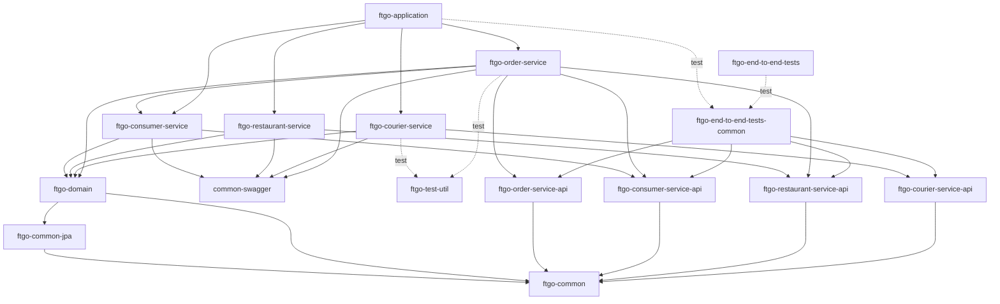

# FTGO Monolith Modernisation Plan: Spring Boot 2.0.3 / Java 8 / `javax.*` → Spring Boot 3.5 / Java 17 / `jakarta.*`

This document is the coordination contract for a multi-session ("swarm") migration. Phases are **strictly ordered**. Inside a phase, every child session owns a **disjoint set of files and modules** and must not edit anything outside that set.

```
Phase 0 ──► Phase 1 ──► Phase 2a ──► Phase 2b (B ‖ C ‖ D ‖ F) ──► Phase 3
toolchain   Boot 3.5    shared        services + application         runtime / verification
(master)    └──────────── integration branch `migration/boot3` ───────┘   (master)
```

---

## 1. Verified baseline (master @ `1fb9c78d`)

| Item | Expected (brief) | Found | Notes |
|---|---|---|---|
| `build.gradle` source/target | `1.8` | `1.8` | applied in `subprojects {}` |
| Repositories | `jcenter()` + dead Bintray | `jcenter()`, commented Eventuate/Bintray + `repo.spring.io` | `mavenCentral()` already present |
| `springBootVersion` | `2.0.3.RELEASE` | `2.0.3.RELEASE` | |
| `springDependencyManagementPluginVersion` | `1.0.3.RELEASE` | `1.0.3.RELEASE` | |
| `micrometerVersion` / `restAssuredVersion` | `1.0.4` / `2.9.0` | `1.0.4` / `2.9.0` | |
| `eventuateMavenRepoUrl` | dead Bintray | dead Bintray | |
| Gradle wrapper | `4.10.2` | `4.10.2` (`-all`) | does not start on JDK 17 |
| `compile`/`testCompile` | throughout | every `build.gradle` + `buildSrc` | also `runtime` |
| `javax.el:javax.el-api:2.2.5` | order-service | **order-, consumer-, courier-, restaurant-service** | 4 modules, not 1 |
| springfox 2.8.0 | `common-swagger` | `common-swagger` (`CommonSwaggerConfiguration`) | only springfox user |
| Dockerfile base | `openjdk:8u171-jre-alpine` | same | |
| compose driver | `com.mysql.jdbc.Driver` | same | also in `buildSrc/WaitForMySql.java` default and `ftgo-order-service/src/test/resources/application.properties` |

Additional baseline problems found (not in the brief):

* `eventuateUtilVersion=0.1.0.RELEASE` is **not on Maven Central** (it was only on Bintray), so `ftgo-end-to-end-tests-common` could not resolve at all.
* `DeliveryInformation.deliveryAddress` did not override the `latitude`/`longitude` columns that `V2__add_courier_optimization_and_api_tracking.sql` added as `delivery_address_latitude/longitude`. As a result, **every `POST /orders` failed with `Unknown column 'latitude'`**. Fixed in Phase 0 because `FtgoApplicationTest` can't pass without it.
* `buildSrc/IntegrationTestsPlugin.groovy` uses APIs that were removed in Gradle 5–8 (`testClassesDir`, `classesDir`, `integrationTestCompile`).
* `ftgo-common` forced the old `com.sun.xml.bind:jaxb-impl:2.2.11` onto the runtime classpath. On JDK 17 that crashes Hibernate boot (`InaccessibleObjectException ... defineClass`).
* `com.jayway.restassured:rest-assured:2.9.0` pulls in Groovy 2.4.4, which fails on JDK 17 unless something manages the version.

## 2. `javax.*` inventory (source of truth for Phase 2)

Found with `grep -rnE "import (static )?javax\." --include=*.java`. There are 33 import lines in **22 files across only 4 modules**. None of the `*-service` modules has a `javax` import.

| Module | Files | Packages |
|---|---|---|
| `ftgo-domain` | 12: `Action`, `Consumer`, `Courier`, `DeliveryInformation`, `MenuItem`, `Order`, `OrderLineItem`, `OrderLineItems`, `PaymentInformation`, `Plan`, `Restaurant`, `RestaurantMenu` | `javax.persistence` |
| `ftgo-common` | 6: `Address`, `Money`, `PersonName`, `tracking/ApiRequestLog` | `javax.persistence` |
| | `CommonJsonMapperInitializer` | `javax.annotation.PostConstruct` |
| | `tracking/ApiTrackingInterceptor` | `javax.servlet.http` |
| `ftgo-restaurant-service-api` | 1: `events/MenuItemDTO` | `javax.persistence` |
| `ftgo-application` | 1: `GlobalExceptionHandler` | `javax.servlet.http` |
| `ftgo-common-jpa` | 0 Java files; `META-INF/orm.xml` uses the `xmlns.jcp.org/.../orm_2_1` namespace | (XML) |

There are no `javax.validation`, `javax.el`, `javax.transaction` or `javax.inject` *imports* anywhere. `javax.el` exists only as a Gradle dependency.

Other Boot 3 breakages found by grep, which the sessions below also own:

| Concern | Where | Owner |
|---|---|---|
| springfox → springdoc (Java config rewrite) | `common-swagger/.../CommonSwaggerConfiguration.java` | Phase 1 |
| `spring.mvc.pathmatch.matching-strategy=ant_path_matcher` workaround | `ftgo-application/src/main/resources/application.properties` | Phase 1 |
| `io.rest-assured:spring-mock-mvc:3.0.6` (javax.servlet-based) | order-service, courier-service `build.gradle`; `OrderControllerTest` | 2b-C, 2b-D |
| `com.jayway.restassured:rest-assured:2.9.0` (Groovy 2.4) | consumer-, restaurant-service `build.gradle`; `ftgo-end-to-end-tests-common` (`AbstractEndToEndTests`) | 2b-B, 2b-D, 2b-F |
| Hibernate 6 `@GeneratedValue` (AUTO) on `Consumer` no longer uses the shared `hibernate_sequence` table | `ftgo-domain/.../Consumer.java` | 2a |
| Jackson `2.9.7` hard pins | `ftgo-common/build.gradle` | 2a |
| Legacy driver property name `spring.datasource.driver.class.name` + `com.mysql.jdbc.Driver` | `ftgo-order-service/src/test/resources/application.properties` | 2b-C |
| JUnit 4 tests (Boot 3 starter-test has no vintage engine) | all test sources | keep JUnit 4 with an explicit `junit:junit` dependency; JUnit 5 is out of scope |

## 3. Module dependency graph (from every `build.gradle`)



What the graph means for parallel work:

* `ftgo-common` sits underneath everything, and `ftgo-domain` underneath every service. They have to be done first (**2a**).
* `common-swagger` is an `api` dependency of every service. Removing springfox breaks compilation of all services, so the swagger rewrite goes into **Phase 1** together with the dependency swap.
* `ftgo-order-service` depends on `ftgo-consumer-service` (main code) and `ftgo-restaurant-service-api`. Those are *compile* edges, not file overlaps: 2b-C must not edit them, it only waits for them to compile.
* `ftgo-application` + `ftgo-end-to-end-tests*` are the leaves and can run alongside the services. Their tests are the integration check, so 2b-F runs its final verification last.

## 4. Phases and child-session assignments

### Phase 0: Build toolchain groundwork (single session, blocking) ✅ executed in this PR

Scope: all `build.gradle` files, `buildSrc/**`, `gradle.properties`, `gradle/wrapper/**`, `gradlew*`, plus the three minimal runtime fixes listed below.

* Gradle wrapper `4.10.2-all` → **`8.14.3-bin`**. This is the last 8.x release. It runs on JDK 17–24 and is supported by both Boot 2.7 and Boot 3.5. Gradle 9 is held back because Boot 2.7's plugin needs the `Convention` APIs that Gradle 9 removes.
* `compile` → `api`/`implementation`, `testCompile` → `testImplementation`, `runtime` → `runtimeOnly`. Subprojects now apply `java-library`.
  * Library modules keep `api`, so consumers see the same transitive API as before.
  * The leaf `ftgo-application` uses `implementation`.
  * `javax.el` became `implementation`, and the MySQL driver in `ftgo-common` became `runtimeOnly`.
* Removed `jcenter()`, the commented Eventuate/Bintray/`repo.spring.io` repos and `eventuateMavenRepoUrl`. `mavenCentral()` stays.
* `sourceCompatibility`/`targetCompatibility` → `JavaVersion.VERSION_17`.
* **Deviation from the brief (required to go green):** `springBootVersion` `2.0.3.RELEASE` → **`2.7.18`**. Related bumps: `springDependencyManagementPluginVersion` → `1.0.15.RELEASE`, `micrometerVersion` → `1.9.17`, `com.github.ben-manes.versions` `0.20.0` → `0.51.0`.
  * Why: the Boot 2.0.3 Gradle plugin crashes on Gradle ≥ 7 (`ArchivePublishArtifact.<init>`), and Spring 5.0 cannot parse Java 17 class files.
  * 2.7.18 is the last Boot 2 release. It is still `javax`-based and is the stepping stone Spring itself recommends, so it removes no work from Phase 2.
* Fixes needed to keep the app booting on JDK 17 / Boot 2.7:
  * Removed the forced `jaxb-api/jaxb-core/jaxb-impl 2.2.11` + `activation 1.1.1` from `ftgo-common`. Hibernate 5.6 brings `jaxb-runtime 2.3.9` itself.
  * `spring.mvc.pathmatch.matching-strategy=ant_path_matcher` plus a `BeanPostProcessor` in `CommonSwaggerConfiguration`. These are the standard springfox-on-Boot-2.6+ workarounds, and Phase 1 deletes both.
  * `ftgo-end-to-end-tests-common` imports `platform(spring-boot-dependencies)` so that Groovy resolves to 3.0.x.
  * `eventuateUtilVersion` → `0.9.0.RELEASE`, the oldest release on Maven Central with the same `Eventually` API.
  * Added `junit:junit:4.12` where JUnit 4 tests had relied on the old starter-test.
* Pre-existing bug fix: `DeliveryInformation` now maps `latitude`/`longitude` to `delivery_address_latitude/longitude`.

**Exit criteria (all met):**
* `./gradlew build` passes on JDK 17: `MoneyTest` 4/4, `MoneySerializationTest` 3/3, `CourierAssignmentStrategyTest` 9/9, `OrderControllerTest` 2/2, `FtgoApplicationTest` 2/2 against MySQL + Flyway.
* `bootJar` starts.
* `/actuator/health` is `UP`, `/swagger-ui.html` and `/v2/api-docs` return 200.
* `./run-end-to-end-tests.sh` passes 2/2 against the running jar.

### Phase 1: Spring Boot 3.5 & dependency bump (single session, creates the integration branch)

Branch `migration/boot3` from master after Phase 0 merges. This session owns:

| File | Change |
|---|---|
| `gradle.properties` | `springBootVersion=3.5.x` (latest 3.5 patch); `springDependencyManagementPluginVersion=1.1.7`; drop the explicit `micrometerVersion` and let the Boot BOM manage micrometer (or set it to the BOM's 1.15.x) |
| `common-swagger/build.gradle` | replace springfox with `org.springdoc:springdoc-openapi-starter-webmvc-ui:2.8.x` |
| `common-swagger/src/**` | rewrite `CommonSwaggerConfiguration`: `GroupedOpenApi` restricted to `net.chrisrichardson.ftgo`, and delete the springfox `BeanPostProcessor` |
| `ftgo-application/src/main/resources/application.properties` | remove `spring.mvc.pathmatch.matching-strategy` |
| `ftgo-{order,consumer,courier,restaurant}-service/build.gradle` | **only** delete the `javax.el:javax.el-api:2.2.5` line (Boot 3 ships `jakarta.el` via `tomcat-embed-el`) |
| `show-swagger-ui-urls.sh`, `open-swagger-uis.sh` | `/swagger-ui.html` stays valid in springdoc (it redirects); update only if the paths are wrong |

**Expected state at exit:** `:common-swagger:compileJava` passes. Compile errors are expected **only** in the four `javax` modules and their dependants, because Boot 3 no longer provides `javax.persistence`/`javax.servlet`. That's why Phase 1 + 2 live on an integration branch and not on master.

**Exit criteria:** `./gradlew :common-swagger:build :ftgo-common-jpa:build :ftgo-test-util:build` passes, and `./gradlew compileJava` fails *only* on `javax.*` symbols (attach the log to the PR).

### Phase 2a: Shared modules (single session, PR into `migration/boot3`)

**Session A owns:** `ftgo-common/**`, `ftgo-common-jpa/**`, `ftgo-domain/**`.

* `javax.persistence` → `jakarta.persistence` (18 files), `javax.annotation.PostConstruct` → `jakarta.annotation.PostConstruct`, `javax.servlet.http` → `jakarta.servlet.http` in `ApiTrackingInterceptor`.
* `orm.xml`: switch to the `https://jakarta.ee/xml/ns/persistence/orm` namespace, `version="3.1"`.
* `ftgo-common/build.gradle`: drop the Jackson `2.9.7` pins (BOM-managed).
* Hibernate 6 ID generation: `Consumer` uses `@GeneratedValue` (AUTO). Hibernate 6 would look for `consumers_SEQ`, but V1 created a single `hibernate_sequence` table. Pin it with `@SequenceGenerator(name="hibernate_sequence", sequenceName="hibernate_sequence", allocationSize=1)` on `Consumer` so that no Flyway change is needed.
* Hibernate 6 / `@Embeddable` `Money`: check that the `orm.xml` override still applies. The `HHH000207` warning on 2.7 shows `Money.amount` is already mis-described; fix or remove that mapping.

**Exit criteria:** `./gradlew :ftgo-common:build :ftgo-common-jpa:build :ftgo-domain:build` passes, and no `javax.(persistence|servlet|annotation)` imports remain in these modules.

### Phase 2b: Services + application (4 parallel sessions, each PRs into `migration/boot3`)

Start only after 2a is merged into `migration/boot3`. Each session owns exactly the paths listed. The 2b sessions have no file overlap.

| Session | Owns | Work |
|---|---|---|
| **B: Restaurant** | `ftgo-restaurant-service-api/**`, `ftgo-restaurant-service/**` | `MenuItemDTO` `javax.persistence` → `jakarta.persistence`. Replace `com.jayway.restassured:rest-assured:2.9.0` + `com.jayway.jsonpath:json-path:2.3.0` with `io.rest-assured:rest-assured:5.5.x` (BOM-managed). Exit: `./gradlew :ftgo-restaurant-service:build` |
| **C: Order** | `ftgo-order-service-api/**`, `ftgo-order-service/**` | `io.rest-assured:{rest-assured,spring-mock-mvc,json-path}:3.0.6` → `5.5.x` (`spring-mock-mvc` 5.x is jakarta). Update `OrderControllerTest` imports if needed. Fix `src/test/resources/application.properties` (`spring.datasource.driver-class-name=com.mysql.cj.jdbc.Driver`). Check `IntegrationTestsPlugin` wiring for the module. Exit: `./gradlew :ftgo-order-service:build`. It needs B's `MenuItemDTO` and D's consumer-service to compile, so run `build` again after they merge |
| **D: Consumer + Courier** | `ftgo-consumer-service-api/**`, `ftgo-consumer-service/**`, `ftgo-courier-service-api/**`, `ftgo-courier-service/**` | No `javax` imports exist here, so the work is dependency-only: consumer swaps `com.jayway` rest-assured for `io.rest-assured 5.5.x`, courier swaps `io.rest-assured 3.0.6` for `5.5.x`. Check that `micrometer-registry-prometheus` is BOM-managed (Prometheus client 1.x in micrometer 1.13+). Merged from the brief's C + E because each half is a few lines. Exit: `./gradlew :ftgo-consumer-service:build :ftgo-courier-service:build` |
| **F: Application + E2E** | `ftgo-application/**` (except `Dockerfile`, which belongs to Phase 3), `ftgo-end-to-end-tests-common/**`, `ftgo-end-to-end-tests/**`, `ftgo-test-util/**` | `GlobalExceptionHandler` `javax.servlet` → `jakarta.servlet`. Migrate `AbstractEndToEndTests` from `com.jayway.restassured.*` to `io.restassured.*` 5.x. Bump `eventuate-util-test` if needed. Check `spring.jpa`/datasource property names for Boot 3. Exit: `./gradlew :ftgo-application:build` (needs MySQL + Flyway) and `./run-end-to-end-tests.sh`. Final run happens after B, C and D merge |

**Phase 2 exit (integration branch):**
* `./gradlew build` passes on `migration/boot3`.
* `grep -rnE "import (static )?javax\.(persistence|servlet|annotation|validation|el)" --include=*.java .` returns nothing.
* `migration/boot3` is merged into master as one PR.

### Phase 3: Runtime/config & verification (single session, from master)

Owns: `ftgo-application/Dockerfile`, `docker-compose.yml`, `buildSrc/src/main/groovy/WaitForMySql.java`, `wait-for-services.sh`, `.circleci/**`, `mysql/Dockerfile`, `deployment/**`.

* `ftgo-application/Dockerfile`: `openjdk:8u171-jre-alpine` → `eclipse-temurin:17-jre-alpine` (or `21-jre-alpine`). `curl` is still needed for `HEALTHCHECK`.
* `docker-compose.yml`: `SPRING_DATASOURCE_DRIVER_CLASS_NAME: com.mysql.cj.jdbc.Driver`. Remove the unused Sleuth/Zipkin/Kafka env vars. Sleuth does not exist on Boot 3; use Micrometer Tracing if tracing is wanted.
* `WaitForMySql.java`: change the default driver to `com.mysql.cj.jdbc.Driver`.
* `wait-for-services.sh`: polls `/health`, but Boot ≥ 2 serves `/actuator/health`. This is a pre-existing bug, so the CI script never finishes on its own.
* `mysql/Dockerfile`: `mysql:5.7.13` is EOL. Consider `mysql:8.0` (needs `allowPublicKeyRetrieval`, which `application.properties` already sets).
* `.circleci/config.yml`: make sure the machine image runs JDK 17.
* Verification: run `./build-and-test-all.sh` (Docker Compose, Flyway, `build`, `integrationTest`, E2E). Then run the existing suites listed in `UNIT_TEST_PLAN.md` (`MoneyTest`, `MoneySerializationTest`, `CourierAssignmentStrategyTest`, `OrderControllerTest`, `FtgoApplicationTest`). `UNIT_TEST_PLAN.md`'s new test classes are a separate track; its `mockito-core:2.23.4` suggestion should become BOM-managed Mockito 5.

## 5. Swarm coordination rules

1. **Ordering:** 0 → 1 → 2a → 2b → 3. A phase starts only when the previous phase's exit criteria are met and its PR is merged into the phase's base branch.
2. **Branches:**
   * Phase 0 and Phase 3 PR to `master`.
   * Phase 1 creates `migration/boot3`.
   * Phase 2a/2b child sessions branch from the current `migration/boot3` and PR back into it.
   * Branch names: `devin/<ts>-boot3-phase<N>-<session>`.
3. **Ownership:** a child session edits only the paths in its row. If it finds a needed change outside them (for example a shared type in `ftgo-common`), it stops and reports to the parent session. The parent makes the change on `migration/boot3` and the child rebases.
4. **Compile edges ≠ file edges:** 2b sessions may be blocked from a *full* `build` until a sibling merges (C waits on B + D, F waits on B + C + D). Each session first proves its own module compiles (`:module:compileJava compileTestJava`) and does its final `build` after rebasing.
5. **Verification per PR:** each PR description includes the exact Gradle command it ran and the test counts. Anything that needs MySQL runs against `docker run mysql:5.7` + `./gradlew :ftgo-flyway:flywayMigrate`, with `DOCKER_HOST_IP=localhost`.
6. **Environment gotchas (Devin VMs):**
   * `repo.maven.apache.org` returns HTTP 429. Use a `~/.gradle/init.d` init script that points at `https://maven-central.storage-download.googleapis.com/maven2/`.
   * Docker Hub pulls can hit 429. `mirror.gcr.io/library/<image>` works.

## 6. Child-session prompts (copy/paste)

* **Phase 1:** "In COG-GTM/ftgo-monolith, execute *Phase 1* of `MIGRATION_PLAN.md`: create branch `migration/boot3` from master, bump to Spring Boot 3.5.x, replace springfox with springdoc in `common-swagger`, remove the `javax.el` lines and the `ant_path_matcher` property. Touch only the files in the Phase 1 table and meet its exit criteria. Open a PR into `migration/boot3`."
* **Phase 2a:** "Execute *Phase 2a / Session A* of `MIGRATION_PLAN.md` on a branch from `migration/boot3`. Own only `ftgo-common/**`, `ftgo-common-jpa/**`, `ftgo-domain/**`. PR into `migration/boot3`."
* **Phase 2b-B / C / D / F:** "Execute *Phase 2b / Session <X>* of `MIGRATION_PLAN.md` on a branch from `migration/boot3` after 2a is merged. Edit only the paths in the Session <X> row. PR into `migration/boot3`, and report any change needed outside your paths instead of making it."
* **Phase 3:** "Execute *Phase 3* of `MIGRATION_PLAN.md` from master after `migration/boot3` is merged."
