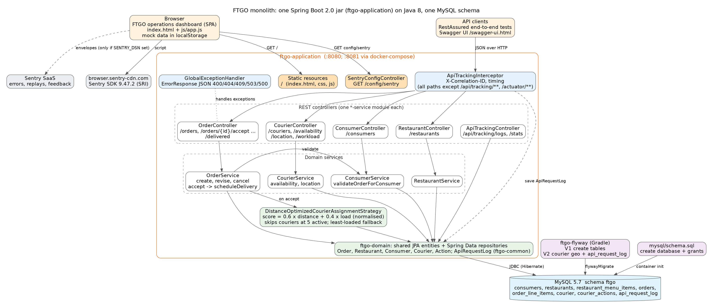

= FTGO Monolith

This is the monolithic version of the https://github.com/microservices-patterns/ftgo-application[FTGO application] from the book https://microservices.io/book[Microservices patterns].
It's used to illustrate how to refactor a monolithic application to services.

This fork adds a browser operations dashboard (mock data, with optional Sentry monitoring), distance-based courier assignment and API request tracking to the original code.

== Architecture

FTGO runs as one Spring Boot 2.0 application (`ftgo-application`, Java 8) backed by one MySQL 5.7 schema.
The consumer, order, restaurant and courier modules are Gradle subprojects loaded into the same process and share the JPA entities in `ftgo-domain`.

See link:docs/architecture.md[docs/architecture.md] for modules, REST API, order lifecycle, persistence and the dashboard, and link:docs/adr/[docs/adr] for decision records.
The diagram source is link:docs/diagrams/architecture.dot[docs/diagrams/architecture.dot] (Graphviz; re-render with `docs/diagrams/render.sh`).

== Prerequisites

* JDK 8 (the code targets Java 8 and builds with the Gradle 4.10.2 wrapper)
* Docker and Docker Compose (for MySQL and the containerised app)

== Build and run

Point the scripts at your Docker host, start MySQL and create the schema:

[source,bash]
----
export DOCKER_HOST_IP=localhost      # or: . ./set-env.sh
docker-compose up -d --build mysql
./gradlew waitForMySql
./gradlew :ftgo-flyway:flywayMigrate
----

Then either run the jar directly (port 8080):

[source,bash]
----
./gradlew :ftgo-application:assemble
java -jar ftgo-application/build/libs/ftgo-application.jar
----

or, after `assemble`, run it in Docker with `docker-compose up -d --build` (port 8081).
`./build-and-run.sh` also builds and starts the stack, but it first runs `docker-compose down -v`, which deletes the database, and it does not migrate; run `./gradlew :ftgo-flyway:flywayMigrate` after it.

[cols="1,2"]
|===
|URL |What

|`http://localhost:8080/`
|Operations dashboard (mock data kept in browser `localStorage`; it does not call the REST API)

|`http://localhost:8080/swagger-ui.html`
|Swagger UI for the REST API

|`http://localhost:8080/actuator/health`
|Health check

|`http://localhost:8080/api/tracking/stats`
|API request statistics
|===

Set `SENTRY_DSN` (and optionally `SENTRY_ENVIRONMENT`) to turn on Sentry monitoring in the dashboard; see link:docs/adr/0001-sentry-browser-monitoring-for-dashboard.md[ADR 0001].

== Tests

* `./gradlew build` runs the unit tests, `FtgoApplicationTest` (RestAssured scenarios against an in-process app, needs the migrated MySQL above) and `ftgo-end-to-end-tests` (the same scenarios against an app already running on port 8081). Add `-x :ftgo-end-to-end-tests:test` when nothing is running there.
* `./build-and-test-all.sh` runs the full pipeline: MySQL, migrations, build, `docker-compose up`, then `ftgo-end-to-end-tests` against port 8081.
* `UNIT_TEST_PLAN.md` lists the planned unit test coverage.

== Learn more

You can learn more by reading the https://microservices.io/refactoring/index.html[Refactoring section of microservices.io] or chapter 13 of the https://microservices.io/book[book].
