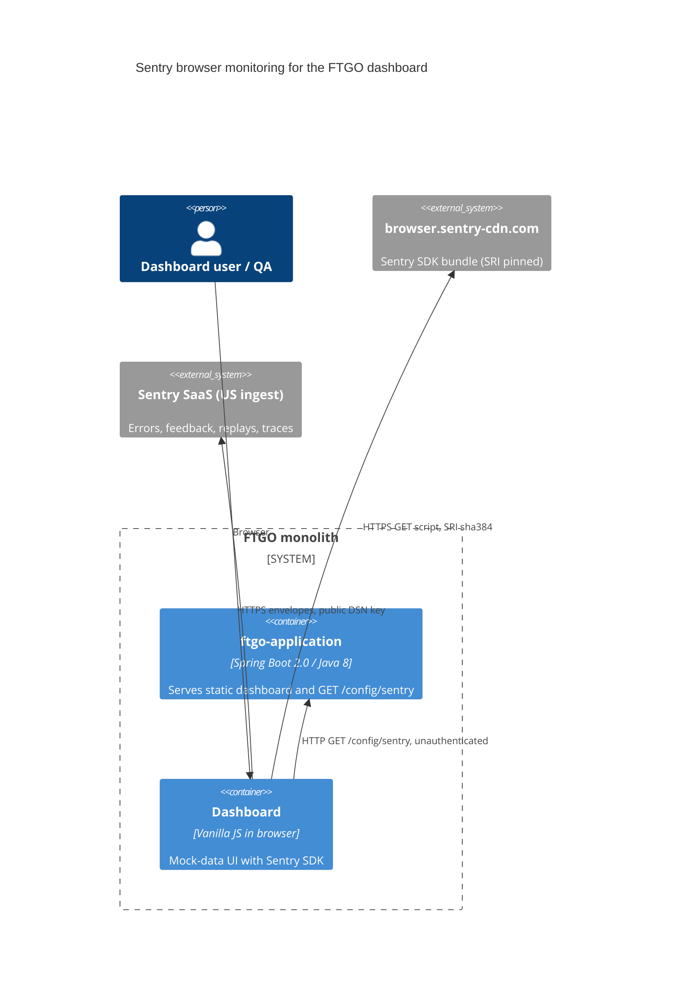

# 0001. Sentry browser monitoring for the FTGO dashboard

- **Status:** Proposed
- **Date:** 2026-10-16
- **ARB ticket:** TO BE CREATED
- **Authors:** Devin (for Abhay Aggarwal)
- **Owning team:** TBD — owner to confirm before ARB
- **Related ADRs:** none

## Context

The FTGO dashboard (`ftgo-application/src/main/resources/static`) is a vanilla-JS single page served by
the Spring Boot monolith. Front-end failures (JS exceptions, error toasts, broken dialogs) are invisible
to engineering today: nothing is reported, and QA bug reports arrive without reproduction context.

We want front-end errors, user-reported bugs, and session replays to land in Sentry
(`abhay-aggarwal/java-spring-boot`) so they can be triaged — including automatically by Devin via the
Sentry integration. Back-end instrumentation is out of scope.

ARB triggers: T3 (new external vendor: Sentry SaaS + `browser.sentry-cdn.com` script), T2 (data
classification: `sendDefaultPii=true` and session replay with text unmasked send user IP, page content and
form input to a third party), T6 (new unauthenticated endpoint `GET /config/sentry`).

## Decision

We will load the Sentry browser SDK 9.47.2 (`bundle.tracing.replay.feedback.min.js`, pinned with SRI)
from Sentry's CDN, initialise it in `js/sentry-init.js` from settings served by a new
`GET /config/sentry` endpoint (`sentry.dsn=${SENTRY_DSN:}`), and enable error capture, error-toast
capture, browser tracing, session replay and the "Report a bug" feedback widget. With no `SENTRY_DSN`
set, the endpoint returns an empty DSN and the SDK is never initialised.

## Alternatives considered

| Alternative | Pros | Cons | Why rejected |
| --- | --- | --- | --- |
| Do nothing | No vendor, no data egress | Front-end failures stay invisible; QA reports lack context | Doesn't meet the goal |
| Hard-code the DSN in `index.html` | Simplest | DSN in source control; one DSN for every environment | Secrets/config must not be committed |
| Self-host the SDK bundle in `static/` | No third-party script origin | 240 KB vendored file to keep patched | CDN + SRI gives the same integrity guarantee with less upkeep |
| Back-end only (`sentry-spring-boot-starter`) | Covers Java exceptions | Dashboard is mock-only and never calls the API, so it would not see UI failures | Doesn't cover the failures we care about |

## Architecture

## Non-functional requirements

| NFR | Target | How met |
| --- | --- | --- |
| Availability SLO | Dashboard unaffected by Sentry outages | SDK failures are caught; app runs if the CDN or `/config/sentry` fails |
| p95 latency | TBD — owner to confirm before ARB | Extra ~240 KB script; `config/sentry` fetch is async |
| RPO / RTO | N/A — no new data store owned by FTGO | |
| Peak load | TBD — owner to confirm before ARB | Sample rates are 1.0 (demo); lower `tracesSampleRate` / `replaysSessionSampleRate` for production |
| Scaling model | N/A — SaaS | |
| Data retention | Sentry plan defaults (TBD) | |

## Security & compliance

- **Data classification:** user IP, URL, page text and form input in replays (text masking disabled). Treat as Internal/PII.
- **Encryption at rest:** Sentry-managed.
- **Encryption in transit:** HTTPS to CDN and ingest.
- **AuthN / AuthZ:** DSN is a public client key by design; `GET /config/sentry` is unauthenticated and returns only DSN, environment and the PII flag.
- **Secrets:** DSN supplied via `SENTRY_DSN` environment variable; not committed.
- **Audit logging:** N/A.
- **Data residency / regions:** Sentry US ingest (`ingest.us.sentry.io`).
- **Policy sections satisfied:** no `policy/approved-infra.yaml` in this repo; no infrastructure added.
- **Threats considered:** CDN script tampering (mitigated by SRI + `crossorigin`); PII leakage via replay (accept for demo; enable `maskAllText` before real customer data).

## Cost

| Item | Assumption | Monthly estimate |
| --- | --- | --- |
| Sentry errors, replays, spans | Existing `abhay-aggarwal` org plan | TBD — owner to confirm before ARB |
| **Total** | | TBD |

## Operations

- **On-call rotation:** TBD — owner to confirm before ARB.
- **Runbook:** set `SENTRY_DSN` (and optionally `SENTRY_ENVIRONMENT`) before starting the JAR.
- **Dashboards / alarms:** Sentry issue stream for project `java-spring-boot`.
- **Rollback plan:** unset `SENTRY_DSN` (SDK stays disabled) or revert the commit.
- **Migration / cut-over plan:** N/A.

## Policy exceptions requested

| Rule | Resource | Justification | Compensating control | Expiry |
| --- | --- | --- | --- | --- |
| none | | | | |

## Consequences

- Positive: front-end errors and QA bug reports reach Sentry with replay context and can be triaged automatically.
- Negative / risks: third-party script and data egress; PII in replays while text masking is off.
- Follow-ups: lower sample rates and enable masking before production use; consider back-end SDK later.

## Open questions

- Owning team, on-call, cost and retention (see TBDs above).
- Whether replay text masking must be on for every environment.
