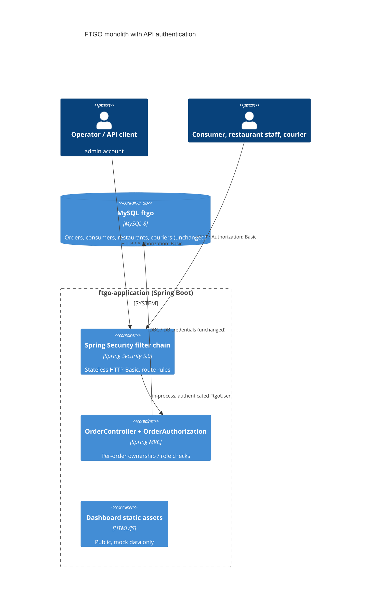

# 0002. Authenticate the API and enforce order ownership on /orders

- **Status:** Proposed
- **Date:** 2026-11-12
- **ARB ticket:** TO BE CREATED
- **Authors:** Devin (code scan remediation)
- **Owning team:** TBD — owner to confirm before ARB
- **Related ADRs:** [0001](0001-sentry-browser-monitoring-for-dashboard.md) (keeps `GET /config/sentry` public)

## Context

The monolith has no authentication layer. `OrderController` acts on whatever order ID or consumer ID
the caller sends, so anyone who can reach the HTTP port (published as 8081 in `docker-compose.yml`) can
list every consumer's orders, cancel or revise any order, advance any order through the
accept/preparing/ready/pickedup/delivered states (accept also adds pickup/drop-off actions to a real
courier's plan), and place orders for any consumer. Order and consumer IDs are sequential. This was
reported by a code scan as missing authentication + IDOR.

ARB triggers: T6 (authentication/authorization boundary change: Spring Security added in front of every
API route), T8 (shared identity type `FtgoUser` added to `ftgo-common`, used across modules).

## Decision

We will add Spring Security (`spring-boot-starter-security`, managed by the existing Spring Boot 2.0.3
BOM) with stateless HTTP Basic authentication. Identities come from configuration: an operator account
(`ftgo.security.admin.*`, password from `FTGO_ADMIN_PASSWORD`; if unset, the admin account is disabled)
and optional consumer / restaurant-staff / courier accounts (`ftgo.security.users.<name>.*`, each bound
to exactly one consumer, restaurant, or courier ID). `OrderController` loads the order first and allows:
the owning consumer to read, cancel and revise; staff of the order's restaurant to read, accept, and mark
preparing/ready; the assigned courier to read and mark picked up/delivered; the operator everything.
Callers who cannot see an order get 404, callers who can see it but may not perform the action get 403.
Consumers can only list and create orders for their own consumer ID. Static dashboard assets,
`/config/sentry`, health/info and Swagger stay public; other actuator endpoints require the operator; all
other API routes require an authenticated caller.

## Alternatives considered

| Alternative | Pros | Cons | Why rejected |
| --- | --- | --- | --- |
| Do nothing / rely on network placement | No change | Repo shows no gateway or firewall; any reachable client can tamper with every order | Leaves the finding open |
| Ownership checks without authentication (trust a caller-supplied ID header) | Small change | Header is attacker-controlled, so the IDOR remains | Not a fix |
| OAuth2/OIDC resource server with an external IdP | Real user lifecycle, tokens, MFA | New vendor/IdP, new infrastructure, much larger change | Out of scope for a remediation; can replace the config-defined user store later without changing the controller checks |
| Session + form login with CSRF tokens | Familiar browser flow | Dashboard is mock-only and makes no API calls; API clients would need CSRF token handling | Stateless header auth avoids ambient browser credentials, so CSRF tokens are not needed |

## Architecture

## Non-functional requirements

| NFR | Target | How met |
| --- | --- | --- |
| Availability SLO | Unchanged | In-process filter, no new runtime dependency |
| p95 latency | TBD — owner to confirm before ARB | BCrypt verification per request adds CPU cost (~tens of ms per check at default strength) |
| RPO / RTO | Unchanged | No new data store |
| Peak load | TBD — owner to confirm before ARB | |
| Scaling model | Unchanged (stateless; no sessions) | |
| Data retention | N/A — no new data stored | |

## Security & compliance

- **Data classification:** Unchanged; order data is now restricted to the parties of the order and the operator.
- **Encryption at rest:** N/A — no new data at rest; configured passwords are stored as `{bcrypt}` hashes.
- **Encryption in transit:** Basic credentials require TLS in any non-local deployment (TLS termination is not in this repo — open question).
- **AuthN / AuthZ:** Stateless HTTP Basic; route rules in `FtgoSecurityConfiguration`; per-order checks in `OrderAuthorization`.
- **Secrets:** `FTGO_ADMIN_PASSWORD` env var; user passwords via externalised config, never committed.
- **Audit logging:** Existing `ApiTrackingInterceptor` request logs; failed authentications return 401 without detail.
- **Data residency / regions:** Unchanged.
- **Policy sections satisfied:** No infrastructure changes; no `policy/approved-infra.yaml` in repo.
- **Threats considered:** Anonymous access (401), IDOR across consumers/restaurants/couriers (404/403), forged consumer ID on create/list (403), CSRF (no ambient credentials: stateless, no session cookie, 401 sends no `WWW-Authenticate: Basic` challenge so browsers never cache credentials), order enumeration (404 for orders the caller cannot see).

## Cost

| Item | Assumption | Monthly estimate |
| --- | --- | --- |
| Spring Security library | Open source, in-process | $0 |
| **Total** | | $0 |

## Operations

- **On-call rotation:** TBD — owner to confirm before ARB
- **Runbook:** Set `FTGO_ADMIN_PASSWORD` for every deployment; API clients and end-to-end tests send Basic credentials (`FTGO_ADMIN_USERNAME`/`FTGO_ADMIN_PASSWORD`).
- **Dashboards / alarms:** Watch 401/403 rates in existing request logs after rollout.
- **Rollback plan:** Revert the PR; no schema or data migration.
- **Migration / cut-over plan:** API clients must start sending credentials before or at deploy.

## Policy exceptions requested

| Rule | Resource | Justification | Compensating control | Expiry |
| --- | --- | --- | --- | --- |
| none | | | | |

## Consequences

- Positive: Anonymous callers can no longer read or change orders; each party can only act on its own orders.
- Negative / risks: Breaking change for existing unauthenticated API clients; identities are config-defined rather than backed by an IdP.
- Follow-ups: Per-resource authorization for `/consumers`, `/restaurants`, `/couriers`; move identities to a real user store or IdP; TLS termination.

## Open questions

- Owning team and on-call rotation.
- Where TLS is terminated in deployed environments.
- Whether a managed IdP (OIDC) should replace config-defined accounts.
