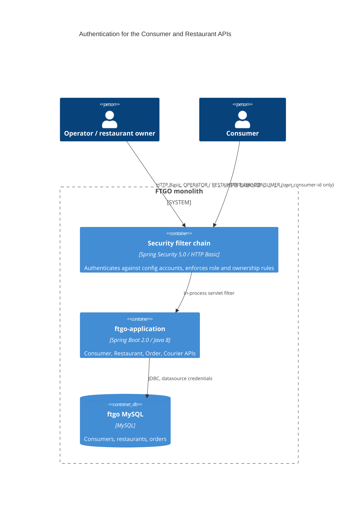

# 0002. Authentication and authorization for the Consumer and Restaurant APIs

- **Status:** Proposed
- **Date:** 2026-11-12
- **ARB ticket:** TO BE CREATED
- **Authors:** Devin (for Abhay Aggarwal)
- **Owning team:** TBD (owner to confirm before ARB)
- **Related ADRs:** none

## Context

The FTGO monolith has no authentication layer. Anyone who can reach the application port (published on
host port 8081 by `docker-compose.yml`) can:

- read the name of every consumer by counting through `GET /consumers/{consumerId}`, since IDs are sequential
  and unused IDs return 404 (code-scan finding sfind-5590a9f98ebe48edbb01577e1da400ab);
- create restaurants with any name, coordinates, menu and prices through `POST /restaurants`, which also
  accepts the body without validation (code-scan finding sfind-203e8cbeea1e4003b7a7b5b29a38adfa).

Both findings have the same root cause, so we add one authentication and authorization layer and apply it
to both routes. The other API routes (orders, couriers, tracking) are out of scope for this change and keep
their current behaviour. Follow-up findings should move them behind the same layer.

ARB triggers: T6 (authentication and authorization change; the `/consumers` routes and `POST /restaurants`
now require credentials).

## Decision

We will add Spring Security (`spring-boot-starter-security`, managed by the existing Spring Boot 2.0.3 BOM)
to `ftgo-application` and use stateless HTTP Basic authentication. Accounts come from configuration
(`ftgo.security.users[n]`: username, BCrypt `password-hash`, `role`, and `consumer-id` for consumers). There
are three roles. `OPERATOR` can create and read any consumer and create restaurants. `RESTAURANT_OWNER` can
create restaurants. `CONSUMER` can read only the consumer record whose ID matches its `consumer-id`. When no
users are configured, every protected route returns 401. `POST /restaurants` also gets bean validation of
the request body, and invalid bodies return 400.

## Alternatives considered

| Alternative | Pros | Cons | Why rejected |
| --- | --- | --- | --- |
| Do nothing | No change | Consumer names stay enumerable; anyone can add restaurants | Leaves both findings open |
| JWT / OIDC resource server with an external IdP | Production-grade; federated identities; token expiry | New vendor dependency (T3); needs an issuer for local runs and tests; larger change | Too large for the fix; still possible later because the authorization rules sit in one `HttpSecurity` config |
| User table in MySQL with self-registration | Real consumer sign-up | New data store holding credentials (T2); migration; password-reset flows | More than the findings need; config accounts are enough for this reference app |
| Network-only control (bind 8081 to localhost, put a proxy in front) | No code change | Doesn't fix the IDOR (any caller can still read every record); deployment-dependent | Doesn't give per-consumer authorization |

## Architecture

## Non-functional requirements

| NFR | Target | How met |
| --- | --- | --- |
| Availability SLO | Unchanged | No new runtime dependency; accounts are in memory |
| p95 latency | TBD (owner to confirm before ARB) | One BCrypt check per protected request (cost 10, about 50–100 ms); other routes are unaffected |
| RPO / RTO | N/A (no new data store) | |
| Peak load | TBD (owner to confirm before ARB) | BCrypt cost can be tuned per account hash |
| Scaling model | Unchanged (stateless) | No sessions, so any instance can serve any request |
| Data retention | N/A | |

## Security & compliance

- **Data classification:** consumer names (PII) are now readable only by operators and by the consumer they belong to.
- **Encryption at rest:** N/A. Passwords are stored only as BCrypt hashes in configuration.
- **Encryption in transit:** HTTP Basic sends credentials on every request, so production needs TLS in
  front of the app (not provided in this repo, TBD by the owner).
- **AuthN / AuthZ:** HTTP Basic. Rules: `GET /consumers/{id}` needs `OPERATOR` or the matching `CONSUMER`.
  The other `/consumers/**` routes need `OPERATOR`. `POST /restaurants` needs `OPERATOR` or
  `RESTAURANT_OWNER`. Rules use `mvcMatchers`, so trailing-slash variants that Spring MVC routes to the same
  handler are covered. CSRF protection is disabled because the API is stateless and uses no cookies.
- **Secrets:** hashes come from environment variables (`FTGO_SECURITY_USERS_<n>_PASSWORD_HASH`); none are committed. Startup fails on a malformed hash.
- **Audit logging:** Spring Security's default authentication-failure logging only (follow-up: structured audit events).
- **Data residency / regions:** N/A.
- **Policy sections satisfied:** no `policy/approved-infra.yaml` in this repo; no infrastructure added.
- **Threats considered:** consumer ID enumeration (blocked: 401 anonymous, 403 for other consumers); anonymous
  catalogue tampering (blocked); malformed restaurant bodies such as negative or sub-cent prices, out-of-range
  coordinates or duplicate menu item IDs (rejected with 400); online password guessing (no rate limiting yet,
  follow-up).

## Cost

| Item | Assumption | Monthly estimate |
| --- | --- | --- |
| Spring Security library | Open source, in-process | $0 |
| **Total** | | $0 |

## Operations

- **On-call rotation:** TBD (owner to confirm before ARB).
- **Runbook:** `README.adoc`, "Authentication" section (how to configure accounts and generate hashes).
- **Dashboards / alarms:** none new. 401/403 rates can be read from the existing request metrics.
- **Rollback plan:** revert the commit. There is no data migration.
- **Migration / cut-over plan:** clients of `/consumers` and `POST /restaurants` must send credentials. Set `FTGO_OPERATOR_PASSWORD_HASH` (Docker Compose) or `ftgo.security.users[n]` before deploying; startup rejects a malformed or empty hash for a configured user.

## Policy exceptions requested

| Rule | Resource | Justification | Compensating control | Expiry |
| --- | --- | --- | --- | --- |
| none | | | | |

## Consequences

- Positive: closes both findings; the same filter chain can protect the remaining routes.
- Negative / risks: accounts are static configuration (no self-service sign-up or rotation tooling); Basic credentials need TLS.
- Follow-ups: put the order, courier and tracking routes behind the same layer; add rate limiting on failed logins; consider an IdP-backed token flow.

## Open questions

- Owning team, on-call, TLS termination and latency budget (see the TBDs above).
- Whether `POST /consumers` should become self-service sign-up instead of operator-only.
