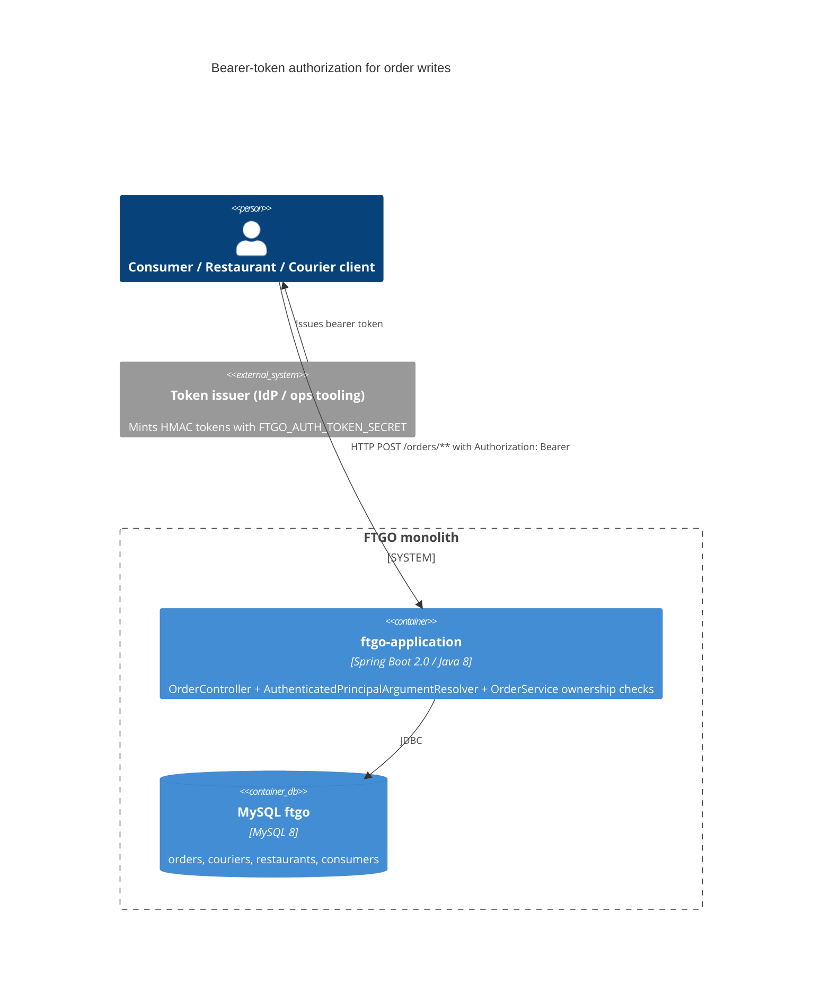

# 0002. Bearer-token authorization for order write endpoints

- **Status:** Proposed
- **Date:** 2026-11-05
- **ARB ticket:** TO BE CREATED
- **Authors:** Devin (code scan remediation)
- **Owning team:** TBD — owner to confirm before ARB
- **Related ADRs:** none

## Context

Every write endpoint under `/orders` (`POST /orders`, `/{orderId}/cancel`, `/revise`, `/accept`,
`/preparing`, `/ready`, `/pickedup`, `/delivered`) was unauthenticated and acted on whatever order or
consumer id the caller supplied. Anyone who could reach the HTTP port could place orders in another
consumer's name, cancel or revise any order, and drive any order through accept → delivered (which also
assigns real couriers). The monolith has no login, no user store and no Spring Security; Spring Boot is
2.0.3 on Java 8.

ARB triggers: T6 (authentication/authorization boundary change on the order API), T8 (new shared
security component in `ftgo-common` used by other modules).

## Decision

We will require an `Authorization: Bearer <token>` header on every order write endpoint. Tokens are
HMAC-SHA256-signed, stateless, expiring, and carry a principal type (`CONSUMER`, `RESTAURANT`, `COURIER`)
and id. They are verified by `AuthTokenService` in `ftgo-common` using the shared secret
`FTGO_AUTH_TOKEN_SECRET` (≥ 32 bytes) and injected into controller methods via
`AuthenticatedPrincipalArgumentResolver`. `OrderService` enforces ownership inside the transaction,
before any state change: consumers may create (for themselves only), revise and cancel their own
orders; the owning restaurant may accept, mark preparing and ready; only the assigned courier may mark
picked up and delivered. Missing/invalid tokens return 401, wrong principals return 403. If no secret is
configured the app uses a random per-process key, so all externally issued tokens are rejected
(fail closed). Token issuance is out of band (identity provider / ops tooling); the app exposes no
issuance endpoint.

## Alternatives considered

| Alternative | Pros | Cons | Why rejected |
| --- | --- | --- | --- |
| Do nothing | No change | Any network caller can tamper with every order | Leaves a critical vulnerability open |
| Spring Security + OAuth2 resource server (JWT) | Standard, IdP-ready | Boot 2.0.3 has no resource-server auto-config; Spring Security auto-config would lock every endpoint (dashboard, consumers, couriers) at once; new dependency and framework surface | Too broad for a targeted fix; revisit with the Boot upgrade |
| HTTP Basic with a user table | Simple | Needs a new credentials store and password management (T2) | Larger data/ops footprint than needed |
| Network-level restriction only | No code | Does not distinguish consumer/restaurant/courier; any internal caller still has full control | Does not provide per-principal authorization |

## Architecture

## Non-functional requirements

| NFR | Target | How met |
| --- | --- | --- |
| Availability SLO | Unchanged | Stateless verification, no new runtime dependency |
| p95 latency | Negligible change | One HMAC-SHA256 per write request |
| RPO / RTO | N/A — no new data store | |
| Peak load | TBD — owner to confirm before ARB | |
| Scaling model | Horizontal; all instances share `FTGO_AUTH_TOKEN_SECRET` | |
| Data retention | N/A | Tokens are not stored |

## Security & compliance

- **Data classification:** tokens carry only principal type, numeric id and expiry (no PII).
- **Encryption at rest:** N/A — nothing persisted.
- **Encryption in transit:** bearer tokens must travel over TLS (terminate TLS in front of the app).
- **AuthN / AuthZ:** HMAC-SHA256 bearer tokens, constant-time signature comparison, expiry enforced;
  ownership checks in `OrderService`.
- **Secrets:** `FTGO_AUTH_TOKEN_SECRET` env var (≥ 32 bytes), never committed; unset → fail closed.
- **Audit logging:** existing `ApiTrackingInterceptor` request log; principal not yet recorded (follow-up).
- **Data residency / regions:** unchanged.
- **Policy sections satisfied:** no `policy/approved-infra.yaml` in this repo; no infrastructure added.
- **Threats considered:** forged/tampered tokens (HMAC), replay after expiry (exp claim), cross-tenant
  order tampering (ownership checks), courier capacity exhaustion via fake accepts (restaurant-only accept).
  Residual: no revocation before expiry; symmetric secret shared with the issuer.

## Cost

| Item | Assumption | Monthly estimate |
| --- | --- | --- |
| None | No new infrastructure or vendor | $0 |
| **Total** | | $0 |

## Operations

- **On-call rotation:** TBD — owner to confirm before ARB.
- **Runbook:** set `FTGO_AUTH_TOKEN_SECRET` on every instance and in the token issuer; rotate by
  redeploying with a new secret (outstanding tokens become invalid).
- **Dashboards / alarms:** 401/403 rates on `/orders/**` (TBD).
- **Rollback plan:** revert the commit.
- **Migration / cut-over plan:** order-write clients must send bearer tokens before this is deployed.

## Policy exceptions requested

| Rule | Resource | Justification | Compensating control | Expiry |
| --- | --- | --- | --- | --- |
| none | | | | |

## Consequences

- Positive: order writes require an authenticated, authorized principal; closes the code-scan finding.
- Negative / risks: breaking change for existing unauthenticated API clients; symmetric secret.
- Follow-ups: protect order read endpoints and the consumer/restaurant/courier write APIs; move to
  an IdP-issued JWT with Spring Security when Spring Boot is upgraded; record principal in API tracking.

## Open questions

- Owning team, on-call, and which identity provider will issue tokens.
