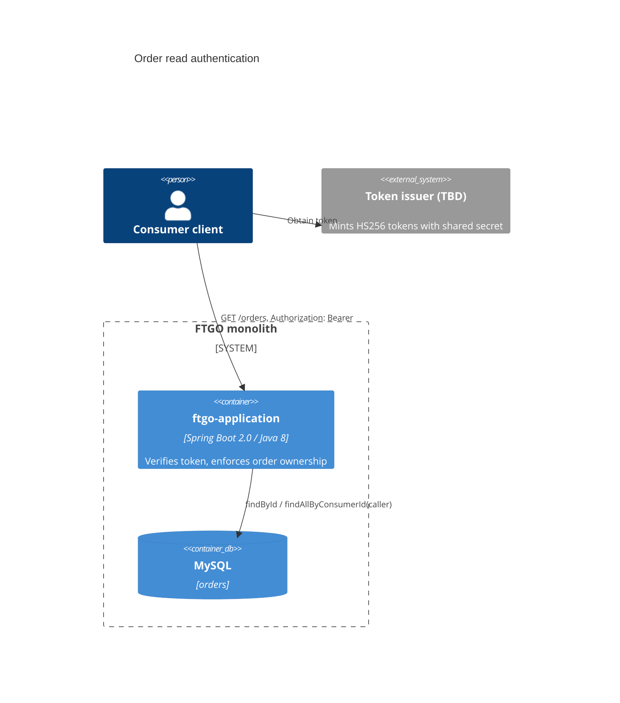

# 0002. Consumer bearer tokens for order read endpoints

- **Status:** Proposed
- **Date:** 2026-11-05
- **ARB ticket:** TO BE CREATED
- **Authors:** Devin
- **Owning team:** TBD — owner to confirm before ARB
- **Related ADRs:** none

## Context

`GET /orders?consumerId=N` and `GET /orders/{orderId}` returned any consumer's orders to any caller.
The app has no authentication layer, so anyone who can reach port 8081 could enumerate every
consumer's order history (code scan finding: IDOR on order reads).

ARB triggers: T6 (authentication/authorization change on public endpoints), T8 (new shared auth
component in `ftgo-common`).

## Decision

Order read endpoints require `Authorization: Bearer <token>`, where the token is an HS256 JWT signed
with `FTGO_CONSUMER_TOKEN_SECRET` (min 32 bytes), with `sub` = consumer ID and a required future `exp`.
`ftgo-common` gains `net.chrisrichardson.ftgo.common.security` (`ConsumerTokenService`,
`ConsumerAuthenticationArgumentResolver`), which injects an `AuthenticatedConsumer` into controller
methods that declare one. `OrderController` uses it to:

- `GET /orders/{id}`: return 404 unless the order belongs to the caller.
- `GET /orders`: return the caller's orders; 403 if `consumerId` names someone else.
- Missing/invalid token: 401 with `WWW-Authenticate: Bearer`.

Token issuance is out of scope: an identity provider (or a future login endpoint) must mint tokens with
the shared secret. With no secret configured, the endpoints fail closed (always 401).

## Alternatives considered

| Alternative | Pros | Cons | Why rejected |
| --- | --- | --- | --- |
| Spring Security + OAuth2 resource server | Standard, full-featured | Needs Spring Security 5.1+ (Boot 2.0.3 ships 5.0); secures every endpoint by default and breaks existing clients | Larger blast radius than this fix; good follow-up |
| jjwt / spring-security-jwt library | Less custom code | New dependency; spring-security-jwt is deprecated | HS256-only verification with a fixed algorithm is small and fully unit-tested |
| Trust a consumer ID header from a gateway | Simple | No gateway exists; header is spoofable | Does not authenticate |

## Architecture

## Non-functional requirements

| NFR | Target | How met |
| --- | --- | --- |
| Availability | Unchanged | Stateless verification, no network call |
| p95 latency | < 1 ms added | One HMAC-SHA256 per request |
| RPO / RTO | N/A — no new data store | |
| Data classification | Unchanged (order data now access-controlled) | |

## Security & compliance

- **AuthN:** HS256 JWT; `alg` must be exactly `HS256` (no `none`/alg confusion); constant-time signature compare; `exp` required, `nbf` honoured.
- **AuthZ:** order ownership check on reads; non-owner single-order reads return 404 (no existence oracle).
- **Secrets:** `FTGO_CONSUMER_TOKEN_SECRET` via environment only; never committed. CI scripts generate a random per-run value.
- **Transport:** bearer tokens are replayable until `exp`; the app serves plain HTTP, so production must terminate TLS in front of it (load balancer/ingress) and issuers should keep token TTLs short.
- **Out of scope:** mutating `/orders` endpoints and other controllers remain unauthenticated (separate findings).

## Cost

None.

## Operations

- **Runbook:** set `FTGO_CONSUMER_TOKEN_SECRET` (>= 32 bytes) on the app and the token issuer; rotate by changing both.
- **Rollback:** revert the commit.

## Consequences

- Positive: order history can no longer be enumerated without a valid token for that consumer.
- Negative: clients of `GET /orders*` must now send a token; there is no issuer in this repo yet.
- Follow-ups: token issuer/login flow; move to Spring Security after a Boot upgrade; protect mutating endpoints.

## Open questions

- Owning team and token issuer.
- Whether restaurant/courier roles need read access to orders tied to them.
