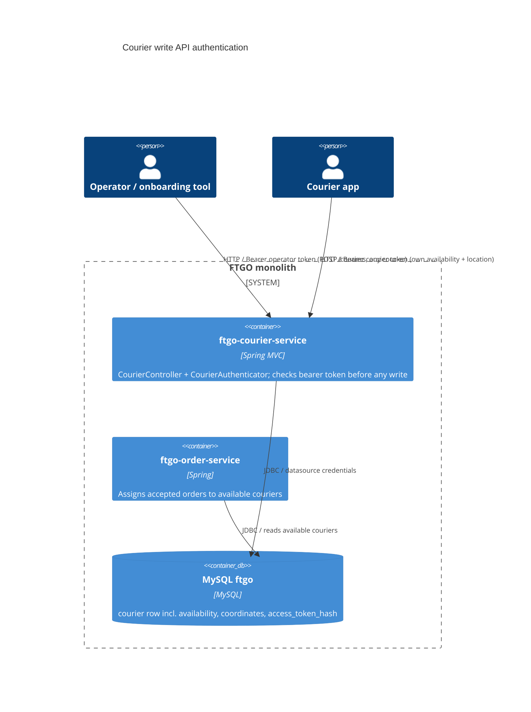

# 0002. Bearer-token authentication for courier write endpoints

- **Status:** Proposed
- **Date:** 2026-11-05
- **ARB ticket:** TO BE CREATED
- **Authors:** Devin (code scan remediation, finding sfind-5c175063854a4d818d483d89a9c33ba9)
- **Owning team:** TBD — owner to confirm before ARB
- **Related ADRs:** none

## Context

`POST /couriers`, `POST /couriers/{courierId}/availability` and `POST /couriers/{courierId}/location`
(`ftgo-courier-service`, `CourierController`) accept requests from anyone who can reach the application
port. Nothing identifies the caller. `OrderService.scheduleDelivery` picks a courier from
`CourierRepository.findAllAvailable()` and `DistanceOptimizedCourierAssignmentStrategy` scores couriers by
their stored coordinates, so an unauthenticated caller can:

- mark every courier unavailable, so every order accept fails with 503 (platform-wide delivery outage);
- create a fake courier, mark it available and place it at a restaurant, so it wins assignment;
- mark an off-shift courier available, or move a courier so they are never chosen.

The monolith has no authentication of any kind today, and adding Spring Security would change the
behaviour of every other endpoint (orders, consumers, restaurants, dashboard, actuator).

ARB triggers: T6 (authentication/authorization added to existing endpoints), T4 (breaking API contract:
the three POST endpoints now require an `Authorization` header and `POST /couriers` returns a new
`accessToken` field), T2 (the `courier` table now stores a credential hash).

## Decision

We will require `Authorization: Bearer <token>` on the three courier write endpoints, enforced in the
courier module by a small `CourierAuthenticator` and a scoped `@ControllerAdvice`, without adding Spring
Security. There are two kinds of principal: an operator, whose token comes from
`ftgo.courier.operator-token` (`FTGO_COURIER_OPERATOR_TOKEN`; blank disables operator access), and a
courier, whose random 256-bit token is generated by `POST /couriers`, returned once, and stored only as a
SHA-256 hash in `courier.access_token_hash` (Flyway V3). Only the operator can create couriers. The
operator or the courier named in `{courierId}` can change that courier's availability and location.
Missing or unknown credentials return 401 with `WWW-Authenticate: Bearer`; a valid principal acting on
another courier returns 403. Coordinates must be finite, latitude in [-90, 90] and longitude in
[-180, 180], otherwise 400.

## Alternatives considered

| Alternative | Pros | Cons | Why rejected |
| --- | --- | --- | --- |
| Do nothing | No contract change | Anyone on the network can stop or hijack all deliveries | Unacceptable security risk |
| Spring Security for the whole monolith | Standard framework, extensible to OAuth2/OIDC | Auto-configuration locks down every endpoint and the dashboard at once; needs a user store and an IdP decision for consumers/restaurants too | Too broad for a targeted fix; should be its own ADR |
| Network restriction only (gateway / ingress allow-list) | No code change | Couriers still need to call these endpoints from devices; no per-courier ownership check, so one courier can still change another | Does not provide authorization |
| Plaintext per-courier token in the DB | Simpler lookup | A DB read leaks working credentials | Hashing costs nothing at this scale |

## Architecture

## Non-functional requirements

| NFR | Target | How met |
| --- | --- | --- |
| Availability SLO | TBD — owner to confirm before ARB | No new runtime dependency; auth is in-process |
| p95 latency | No measurable change expected | One SHA-256 and at most one indexed lookup per write request |
| RPO / RTO | Unchanged | No new data store |
| Peak load | TBD — owner to confirm before ARB | Unique index on `access_token_hash` |
| Scaling model | Unchanged (stateless, token checked against DB) | |
| Data retention | Token hash lives as long as the courier row | |

## Security & compliance

- **Data classification:** courier access token hash is a credential (confidential). Raw tokens are never stored or logged.
- **Encryption at rest:** unchanged (MySQL as deployed).
- **Encryption in transit:** unchanged; bearer tokens need TLS at the ingress in any non-local deployment.
- **AuthN / AuthZ:** bearer tokens; operator = all couriers + create; courier = own record only.
- **Secrets:** operator token injected via `FTGO_COURIER_OPERATOR_TOKEN` (not committed; `set-env.sh` generates a random one for local/CI runs). Fail closed when unset.
- **Audit logging:** 401/403 responses are recorded by the existing `ApiTrackingInterceptor` (`api_request_log`); no ERROR-level logging, to avoid unauthenticated log flooding.
- **Data residency / regions:** unchanged.
- **Policy sections satisfied:** no new infrastructure.
- **Threats considered:** unauthenticated writes, cross-courier tampering (IDOR), fake courier creation, out-of-range/non-finite coordinates, timing attacks on the operator token (constant-time digest compare), credential leakage via `GET /couriers/{id}` (hash is `@JsonIgnore`).

## Cost

| Item | Assumption | Monthly estimate |
| --- | --- | --- |
| None | In-process check, one nullable column | $0 |
| **Total** | | $0 |

## Operations

- **On-call rotation:** TBD — owner to confirm before ARB
- **Runbook:** README.adoc, "Courier API authentication"
- **Dashboards / alarms:** spikes of 401/403 on `/couriers/*` in `api_request_log`
- **Rollback plan:** revert the PR; V3 only adds a nullable column and index, which the old code ignores.
- **Migration / cut-over plan:** set `FTGO_COURIER_OPERATOR_TOKEN` before deploying. Couriers created before the change have no token and can only be managed by the operator until they are re-onboarded.

## Policy exceptions requested

| Rule | Resource | Justification | Compensating control | Expiry |
| --- | --- | --- | --- | --- |
| none | | | | |

## Consequences

- Positive: closes unauthenticated control of courier availability, location and creation.
- Negative / risks: breaking change for any client calling the three POST endpoints without a token; operator token is a shared secret and needs rotation by redeploy.
- Follow-ups: app-wide authentication (IdP, consumer/restaurant principals) in a separate ADR; token rotation/revocation endpoint for couriers.

## Open questions

- Owning team, on-call rotation and availability SLO.
- Should existing couriers be issued tokens through a migration/onboarding flow?
