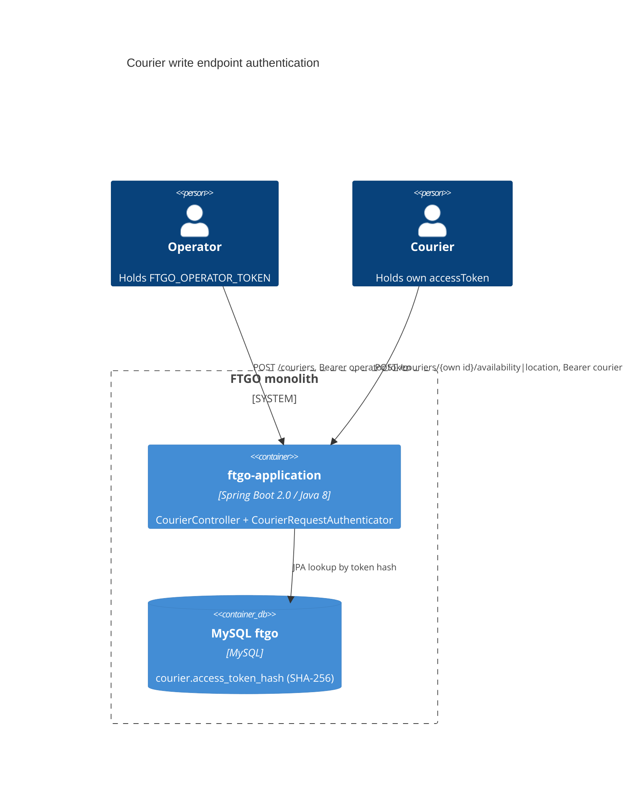

# 0002. Bearer authentication and ownership checks for courier write endpoints

- **Status:** Proposed
- **Date:** 2026-11-12
- **ARB ticket:** TO BE CREATED
- **Authors:** Devin
- **Owning team:** TBD — owner to confirm before ARB
- **Related ADRs:** none

## Context

`POST /couriers`, `POST /couriers/{courierId}/availability` and `POST /couriers/{courierId}/location`
had no authentication and changed whichever courier the URL named. Anyone who could reach the
application port (8081 in `docker-compose.yml`) could take every courier off shift (so
`OrderService.scheduleDelivery` fails with `NoCourierAvailableException`), register fake couriers, or
write arbitrary positions that steer `DistanceOptimizedCourierAssignmentStrategy`. Coordinates were not
range-checked.

ARB triggers: T6 (authentication/authorization change on existing endpoints), T2 (new
`courier.access_token_hash` column holding credential material).

## Decision

- An operator bearer token, configured by `FTGO_OPERATOR_TOKEN` (`ftgo.security.operator-token`), is
  required to create couriers and may update any courier. If unset, operator access is disabled (fail
  closed).
- `POST /couriers` returns a per-courier `accessToken` (32 random bytes, base64url) once. Only its
  SHA-256 hash is stored, in `courier.access_token_hash` (unique index, Flyway `V3`).
- The availability and location routes require `Authorization: Bearer <token>`. The caller's courier is
  resolved from the token hash, and the URL `courierId` must match it unless the caller is the operator.
- Missing or unknown credentials return 401 with `WWW-Authenticate: Bearer`; another courier's ID
  returns 403; latitude outside [-90, 90], longitude outside [-180, 180] or non-finite values return 400.
- The checks live in the courier web layer (`CourierRequestAuthenticator`, `CourierWebExceptionHandler`).
  No new dependency.

## Alternatives considered

| Alternative | Pros | Cons | Why rejected |
| --- | --- | --- | --- |
| Do nothing | No change | Platform-wide dispatch denial/redirection by unauthenticated callers | Not acceptable |
| Spring Security + user accounts for the whole app | Standard framework, covers every route | New dependency, secures every route at once, needs an account model and login flow | Larger than this fix; can replace this mechanism later |
| Network-only restriction (bind to localhost / gateway) | No code change | Does not stop couriers from changing each other; depends on deployment | Does not address the IDOR |

## Architecture

## Non-functional requirements

| NFR | Target | How met |
| --- | --- | --- |
| Availability SLO | Unchanged | No new runtime component |
| p95 latency | +1 indexed lookup per courier write | Unique index on `access_token_hash` |
| RPO / RTO | Unchanged | Existing MySQL |
| Peak load | TBD — owner to confirm before ARB | |
| Data retention | Token hash lives as long as the courier row | |

## Security & compliance

- **Data classification:** courier access token hashes are credential material (Confidential). Plain tokens are never stored or logged.
- **Encryption in transit:** unchanged (deployment-dependent; TLS should terminate in front of port 8081).
- **AuthN / AuthZ:** bearer tokens; operator vs. owning courier, as described above. Operator token compared in constant time.
- **Secrets:** `FTGO_OPERATOR_TOKEN` from the environment; not committed.
- **Audit logging:** none added. Follow-up.
- **Threats considered:** token guessing (256-bit tokens); DB leak (only hashes stored); existing couriers with no token can only be managed by the operator.
- **Out of scope:** the GET courier routes and other services' endpoints (separate findings).

## Cost

None.

## Operations

- **Runbook:** set `FTGO_OPERATOR_TOKEN` before starting the JAR or Docker Compose; hand each courier the `accessToken` from `POST /couriers`.
- **Rollback plan:** revert the commit; the `V3` column is nullable and harmless if left in place.
- **Migration:** Flyway `V3__add_courier_access_token_hash.sql`. Existing couriers get no token; re-create them or manage them with the operator token.

## Policy exceptions requested

| Rule | Resource | Justification | Compensating control | Expiry |
| --- | --- | --- | --- | --- |
| none | | | | |

## Consequences

- Positive: unauthenticated callers can no longer change courier availability, location or create couriers; couriers can only change their own record.
- Negative / risks: clients of these routes must now send a bearer token; token rotation/revocation is not yet supported.
- Follow-ups: token rotation, audit logging, and a common authentication layer for all routes.

## Open questions

- Owning team and on-call.
- Whether to consolidate on Spring Security once other routes are secured.
