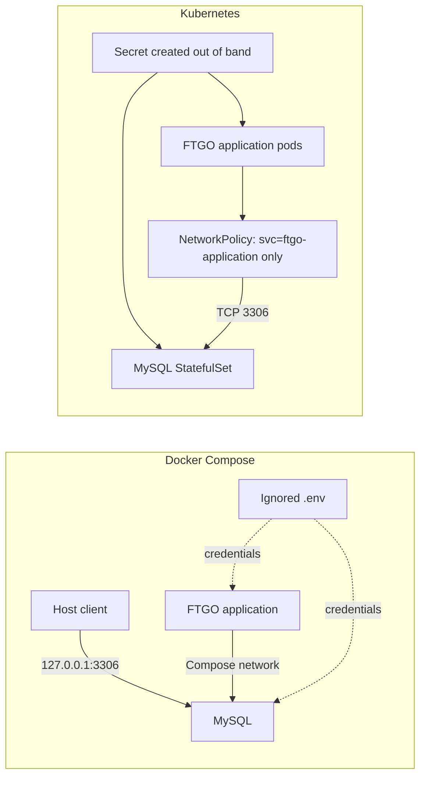

# 0002. Externalize MySQL credentials and restrict network access

- **Status:** Proposed
- **Date:** 2026-11-12
- **ARB ticket:** TO BE CREATED
- **Authors:** Devin (for Abhay Aggarwal)
- **Owning team:** TBD — owner to confirm before ARB
- **Related ADRs:** none

## Context

MySQL root and application credentials have been committed in Compose, Kubernetes,
Flyway, and application configuration. Compose publishes MySQL on all host
interfaces, and the Kubernetes deployment has no network policy restricting
database ingress. The credentials must be externalized for each runtime, MySQL
must be restricted to loopback on local hosts, and Kubernetes must limit database
ingress to the application pods.

ARB triggers: T6 (network-boundary change: loopback host binding and Kubernetes
NetworkPolicy; secrets handling).

## Decision

We will require `MYSQL_ROOT_PASSWORD` and `MYSQL_PASSWORD` at runtime, generate
independent random local credentials into a permission-restricted ignored `.env`
file, and use Kubernetes Secrets created out of band. MySQL host publishing will
default to loopback, and a Kubernetes NetworkPolicy will permit MySQL ingress
only from pods labelled `svc: ftgo-application`. The application database user
is fixed as `mysqluser` and will receive only SELECT, INSERT, UPDATE, and DELETE
on the `ftgo` schema; Flyway will authenticate as root or an explicitly
configured migration user.

## Alternatives considered

| Alternative | Pros | Cons | Why rejected |
| --- | --- | --- | --- |
| Do nothing | No implementation effort | Credentials remain exposed in source control; MySQL remains reachable on all host interfaces; Kubernetes has no ingress restriction | Does not remediate either finding |
| Docker secrets | Dedicated Compose secret interface | Requires additional Compose deployment setup; not directly shared by local app and Flyway tooling | The existing environment-variable contract is simpler for this repository's local development flow |
| External Secrets or Sealed Secrets | Integrates Kubernetes secrets with an external secret manager or encrypted GitOps workflow | Requires cluster integrations and operational ownership not present in this repository | Recommended next step for real clusters; out of scope for this repository change |

## Architecture

## Non-functional requirements

| NFR | Target | How met |
| --- | --- | --- |
| Availability SLO | TBD — owner to confirm | MySQL remains the existing single-instance database |
| p95 latency | N/A — no intended query-path change | Database access remains on local Compose/Kubernetes networks |
| RPO / RTO | TBD — owner to confirm | Existing database persistence and recovery remain unchanged |
| Peak load | TBD — owner to confirm | No capacity or workload changes |
| Scaling model | N/A — existing single MySQL instance | No scaling change |
| Data retention | Existing database policy | No retention change |

## Security & compliance

- **Data classification:** Database credentials are secrets; FTGO database data classification remains TBD — owner to confirm.
- **Encryption at rest:** Depends on local filesystem or cluster storage configuration; no new encryption mechanism is introduced.
- **Encryption in transit:** Existing local/cluster database transport; TLS is not changed by this decision.
- **AuthN / AuthZ:** Required MySQL credentials; the app user receives only SELECT, INSERT, UPDATE, and DELETE on `ftgo`; Flyway uses a root or configured migration account.
- **Secrets:** Random local credentials are kept in ignored `.env`; Kubernetes credentials are supplied through `ftgo-db-secret` and referenced with `secretKeyRef`.
- **Audit logging:** Existing MySQL and cluster audit configuration; no change.
- **Data residency / regions:** N/A for local Compose; Kubernetes cluster location remains environment-specific.
- **Policy sections satisfied:** No `policy/approved-infra.yaml` is present in this repo; host and pod ingress boundaries are restricted as described.
- **Threats considered:** Accidental credential disclosure in tracked files; unauthorized access through host interfaces or unlabelled pods; weak database privileges.

## Cost

| Item | Assumption | Monthly estimate |
| --- | --- | --- |
| Credential generation and Kubernetes NetworkPolicy | Existing tools and cluster capabilities | N/A — no new paid service or infrastructure |
| **Total** | | N/A |

## Operations

- **On-call rotation:** TBD — owner to confirm.
- **Runbook:** Generate local credentials with `./create-local-env.sh`; create the Kubernetes Secret with `./deployment/kubernetes/misc/create-db-secret.sh`. To rotate credentials, update the Secret and every running MySQL/application instance in a coordinated operation, including restarting or recreating pods/containers that consume the credentials. The old credentials remain in Git history forever and must be treated as compromised.
- **Dashboards / alarms:** Existing database and cluster monitoring; no change.
- **Rollback plan:** Revert the deployment change only after preparing replacement credentials and network controls; do not restore credentials from source control.
- **Migration / cut-over plan:** Generate runtime credentials, recreate databases/containers or migrate persistent database credentials as required, create the Kubernetes Secret before applying manifests, and verify application connectivity. Existing persisted MySQL volumes may need an explicit credential rotation because image initialization variables do not rotate accounts in an initialized data directory.

## Policy exceptions requested

| Rule | Resource | Justification | Compensating control | Expiry |
| --- | --- | --- | --- | --- |
| none | | | | |

## Consequences

- Positive: credentials are no longer embedded in tracked configuration, local MySQL is not published beyond loopback by default, and Kubernetes limits database ingress.
- Negative / risks: every deployment must provide credentials; Kubernetes enforcement depends on a NetworkPolicy-capable CNI; rotating credentials requires coordinated updates to every running instance.
- Follow-ups: use External Secrets or Sealed Secrets for real clusters; define a production credential rotation and data-classification owner.

## Open questions

- Confirm the owning team, operational SLOs, data classification, and production secret-management approach before ARB approval.
