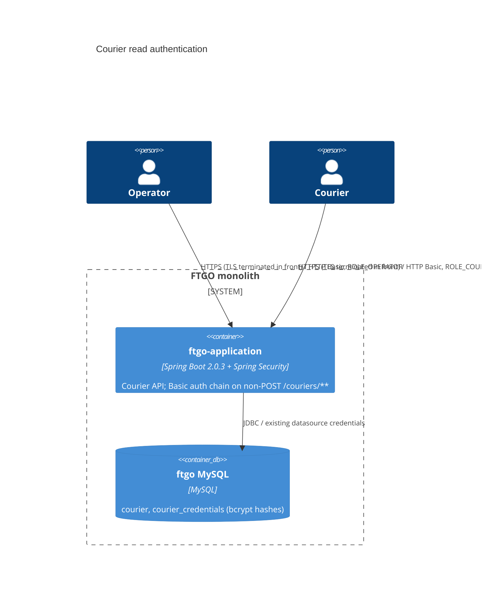

# 0002. HTTP Basic authentication and ownership checks for courier read endpoints

- **Status:** Proposed
- **Date:** 2026-11-12
- **ARB ticket:** TO BE CREATED
- **Authors:** Devin (code-scan remediation, finding `sfind-be57c2aa286a485d8b5133b41aa12af3`)
- **Owning team:** TBD — owner to confirm before ARB
- **Related ADRs:** 0001 (unrelated; Sentry browser monitoring)

## Context

`GET /couriers/{courierId}` returned the `Courier` JPA entity (name, home address, live latitude/longitude)
and `GET /couriers/{courierId}/workload` returned live location, both without authentication. Courier IDs
are sequential, so anyone who can reach the application port could enumerate every courier's home address
and current position. The monolith has no authentication layer today.

ARB triggers: T6 (new authentication/authorization boundary on `/couriers/**` reads), T2 (new
`courier_credentials` table storing credential hashes). The detector's T1 hit on `docker-compose.yml` is a
false positive: only two environment variables were added, no new service.

## Decision

We will add Spring Security (Boot 2.0.3 BOM) to `ftgo-courier-service` with one stateless HTTP Basic filter
chain that applies only to non-POST requests under `/couriers/**`. An operator account is configured from
`FTGO_OPERATOR_USERNAME` / `FTGO_OPERATOR_PASSWORD` (no default password; blank means no operator account).
Courier logins are stored as bcrypt hashes in a new `courier_credentials` table (Flyway `V3`) and provisioned
by the operator with `PUT /couriers/{id}/credentials`. A courier can read only their own record and workload;
an operator can read any. `GET /couriers/{id}` returns a `CourierDetailsResponse` DTO without address or
location. All other routes, including courier POST writes, are not touched by the filter chain.

## Alternatives considered

| Alternative | Pros | Cons | Why rejected |
| --- | --- | --- | --- |
| Do nothing | No change | Courier home addresses and live locations stay public | Personal-data breach and physical-safety risk |
| Operator-only access (no courier logins) | No schema change | Couriers cannot read their own record; recommendation asks for owner access | Does not meet the remediation requirement |
| Application-wide auth for every route (users table for all roles) | Closes other unauthenticated routes too | Large blast radius, breaks all existing API clients at once | Out of scope for this finding; separate findings/PRs cover other routes |
| External IdP (OIDC/JWT) | Industry standard, no local password storage | New vendor/infrastructure, larger change | Too large for this remediation; can replace Basic later behind the same policy |

## Architecture

## Non-functional requirements

| NFR | Target | How met |
| --- | --- | --- |
| Availability SLO | TBD — owner to confirm before ARB | Unchanged; no new runtime dependency |
| p95 latency | TBD — owner to confirm before ARB | Adds one bcrypt check (~50–100 ms) per authenticated request (stateless) |
| RPO / RTO | Same as ftgo MySQL | New table lives in the existing database |
| Peak load | TBD — owner to confirm before ARB | |
| Scaling model | Unchanged | Stateless; no session store |
| Data retention | Credentials kept while courier exists | Row is replaced on re-provisioning |

## Security & compliance

- **Data classification:** courier credentials (bcrypt hashes) — confidential. Courier PII is no longer returned to unauthenticated callers; address is removed from the read DTO.
- **Encryption at rest:** same as existing MySQL deployment (TBD — owner to confirm).
- **Encryption in transit:** HTTP Basic requires TLS in front of the app outside local development.
- **AuthN / AuthZ:** HTTP Basic; `ROLE_OPERATOR` (any courier, provisioning) and `ROLE_COURIER` (own record only). Ownership is checked before the database lookup so callers cannot probe which IDs exist.
- **Secrets:** operator password from `FTGO_OPERATOR_PASSWORD`, never committed; CI generates a random one per run.
- **Audit logging:** none added (TBD — follow-up).
- **Data residency / regions:** unchanged.
- **Policy sections satisfied:** no new infrastructure; `policy/approved-infra.yaml` not applicable.
- **Threats considered:** unauthenticated enumeration (401), cross-courier IDOR (403), stale/bogus Basic headers on public routes (chain not applied), operator-username squatting by couriers (rejected), duplicate usernames (409).

## Cost

| Item | Assumption | Monthly estimate |
| --- | --- | --- |
| None | No new infrastructure | $0 |
| **Total** | | $0 |

## Operations

- **On-call rotation:** TBD — owner to confirm before ARB
- **Runbook:** README "Authentication" section
- **Dashboards / alarms:** none added
- **Rollback plan:** revert the PR; `courier_credentials` can remain (unused) or be dropped by a follow-up migration
- **Migration / cut-over plan:** apply Flyway V3, set `FTGO_OPERATOR_PASSWORD`, provision courier credentials; API clients reading `/couriers/{id}` or `/workload` must send Basic credentials

## Policy exceptions requested

| Rule | Resource | Justification | Compensating control | Expiry |
| --- | --- | --- | --- | --- |
| none | | | | |

## Consequences

- Positive: courier home addresses and live locations are no longer public; owner/operator access model in place.
- Negative / risks: breaking change for clients of courier GET endpoints; Basic auth over plain HTTP would expose passwords without TLS.
- Follow-ups: authenticate courier POST writes and the rest of the API; consider OIDC; add audit logging.

## Open questions

- Owning team, NFR targets, and on-call rotation.
- Whether other open auth PRs (#398, #410, #414) should be consolidated with this one.
