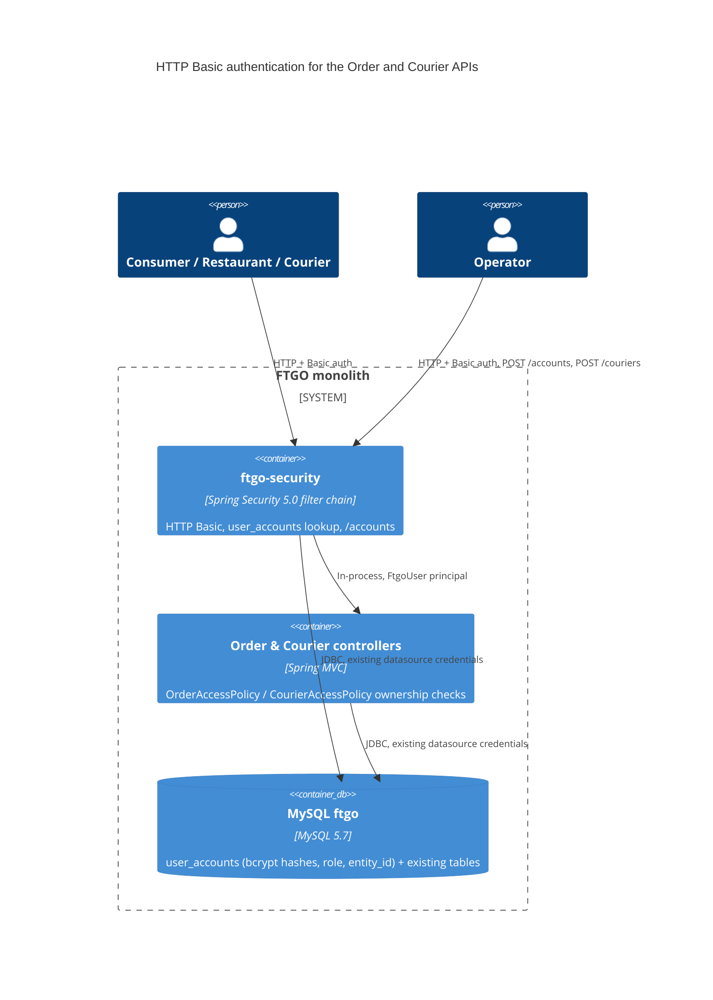

# 0002. HTTP Basic authentication and ownership checks for the Order and Courier APIs

- **Status:** Proposed
- **Date:** 2026-11-12
- **ARB ticket:** TO BE CREATED
- **Authors:** Devin (for Abhay Aggarwal)
- **Owning team:** TBD — owner to confirm before ARB
- **Related ADRs:** [0001](0001-sentry-browser-monitoring-for-dashboard.md) (unrelated; `GET /config/sentry` stays public)

## Context

The monolith has no authentication. Every `/orders` and `/couriers` route accepts any caller and acts on
whatever IDs appear in the path, body (`CreateOrderRequest.consumerId`) or query string
(`GET /orders?consumerId=`). A code scan recorded a courier-dispatch attack chain: an anonymous caller
moves a courier and marks it available, accepts an order so the courier is assigned, reads the order to
learn the courier ID, then reads `GET /couriers/{id}`, which serialised the `Courier` JPA entity (name,
home address, plan, live coordinates). Coordinates were stored without range validation.

The scan asks for one authentication layer in the application and caller identity/ownership checks for
the consumer, restaurant, assigned courier and an operator role.

ARB triggers: T6 (new authentication/authorization boundary on `/orders/**`, `/couriers/**`, new
operator-only `/accounts`), T2 (new `user_accounts` table holding credential hashes and role mappings),
T8 (new `ftgo-security` module shared by the order and courier modules). The detector's T1 hit on
`docker-compose.yml` is a false positive: it only adds two environment variables, no new service.

## Decision

We will add Spring Security (`spring-boot-starter-security`, same Boot 2.0.3 BOM) in a new `ftgo-security`
module imported once by `FtgoApplicationMain`. Requests are authenticated statelessly with HTTP Basic
against a `user_accounts` table (bcrypt via `DelegatingPasswordEncoder`). Each account has a `Role`
(`CONSUMER`, `RESTAURANT`, `COURIER`, `OPERATOR`) and an `entity_id` linking it to the consumer, restaurant
or courier it represents. `/orders/**` and `/couriers/**` require authentication; `POST /couriers` and
`/accounts/**` require `OPERATOR`. Controllers enforce ownership through `OrderAccessPolicy` and
`CourierAccessPolicy` (403 on mismatch), derive the consumer from the principal on order create/list,
return `GetCourierResponse` instead of the entity, and `CourierService.updateLocation` rejects
out-of-range coordinates (400). The first operator is bootstrapped from `FTGO_OPERATOR_PASSWORD`; operators
provision other accounts via `POST /accounts`. Other routes (`/consumers`, `/restaurants`, dashboard,
swagger, actuator, `/config/sentry`) are unchanged.

## Alternatives considered

| Alternative | Pros | Cons | Why rejected |
| --- | --- | --- | --- |
| Do nothing | No change for API clients | Attack chain stays open; courier PII and location exposed | Leaves the findings unremediated |
| External IdP (OIDC/JWT resource server) | Standard SSO, token expiry, no local credentials | Needs an IdP, Spring Security OAuth upgrades beyond Boot 2.0.3, and new infra/vendor (T3/T5) | Larger scope than this remediation; can replace the authentication mechanism later without changing the ownership checks |
| Trusted header from an API gateway (`X-User-Id`) | No credentials in the app | No gateway exists; headers are spoofable when the app is reached directly (port 8081 is published) | Doesn't establish identity |
| Session/form login | Built in | Cookies require CSRF protection; clients are REST/RestAssured | Stateless Basic fits the API |

## Architecture

## Non-functional requirements

| NFR | Target | How met |
| --- | --- | --- |
| Availability SLO | Unchanged from today | No new runtime dependency; auth uses the existing MySQL datasource |
| p95 latency | TBD — owner to confirm before ARB | Adds one indexed `user_accounts` lookup and one bcrypt verify (~tens of ms) per request |
| RPO / RTO | Same as the existing `ftgo` database | Table lives in the existing schema and backups |
| Peak load | TBD — owner to confirm before ARB | Bcrypt cost per request scales with request rate; a token scheme would remove it |
| Scaling model | Stateless; horizontal | `SessionCreationPolicy.STATELESS` |
| Data retention | Accounts kept until deleted | No deletion endpoint yet (follow-up) |

## Security & compliance

- **Data classification:** credential hashes and role mappings (Confidential). Courier name/address/location now visible only to the courier and operators.
- **Encryption at rest:** as for the existing MySQL volume; passwords stored as bcrypt hashes only.
- **Encryption in transit:** HTTP Basic sends credentials on every request — TLS must terminate in front of the app in any non-local environment (open question).
- **AuthN / AuthZ:** HTTP Basic (401 + `WWW-Authenticate: Basic realm="ftgo"`); role URL rules plus per-resource ownership checks (403).
- **Secrets:** operator bootstrap password from `FTGO_OPERATOR_PASSWORD`; nothing committed. Bootstrap never overwrites an existing account and never logs the password.
- **Audit logging:** existing API tracking interceptor logs requests; authenticated username is not yet included (follow-up).
- **Data residency / regions:** unchanged.
- **Policy sections satisfied:** no `policy/approved-infra.yaml` in this repo; no infrastructure added.
- **Threats considered:** anonymous access, IDOR on order/courier IDs, consumer-ID spoofing in body/query, courier PII exposure, invalid coordinates; CSRF not applicable (no cookies/sessions). Brute force on Basic auth is not rate-limited (follow-up).

## Cost

| Item | Assumption | Monthly estimate |
| --- | --- | --- |
| Additional compute for bcrypt | Existing instance | ~$0 |
| **Total** | | ~$0 new recurring spend |

## Operations

- **On-call rotation:** TBD — owner to confirm before ARB.
- **Runbook:** set `FTGO_OPERATOR_PASSWORD` (and optionally `FTGO_OPERATOR_USERNAME`) on first start, then create accounts with `POST /accounts` (see README "Authentication").
- **Dashboards / alarms:** 401/403 rates via existing API tracking logs.
- **Rollback plan:** revert the PR; V3 migration only adds `user_accounts` and can be left in place or dropped.
- **Migration / cut-over plan:** breaking change for API clients of `/orders` and `/couriers` — they must send Basic credentials. Deploy V3 Flyway migration first, bootstrap the operator, provision client accounts, then roll out.

## Policy exceptions requested

| Rule | Resource | Justification | Compensating control | Expiry |
| --- | --- | --- | --- | --- |
| none | | | | |

## Consequences

- Positive: closes the courier-dispatch attack chain; all order/courier actions are tied to an authenticated identity.
- Negative / risks: breaking API change; Basic credentials need TLS; per-request bcrypt cost.
- Follow-ups: protect `/consumers` and `/restaurants` (separate findings); login rate limiting; account management (disable/rotate); include principal in API tracking logs; consider OIDC/JWT.

## Open questions

- Owning team, on-call and latency/peak-load targets (see TBDs).
- Where TLS terminates for deployed environments.
