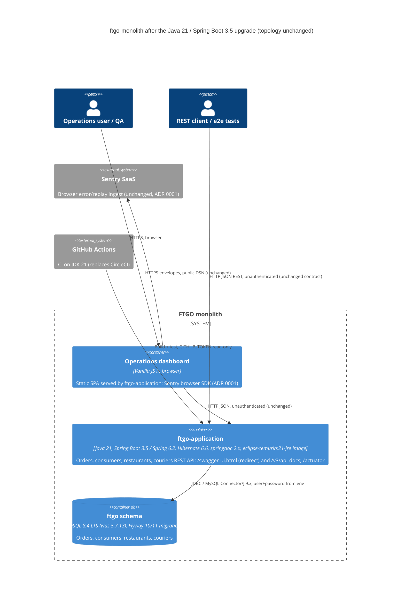

# 0002. Java 21 / Spring Boot 3.5 / Jakarta EE 10 for ftgo-monolith

- **Status:** Proposed
- **Date:** 2026-11-05
- **ARB ticket:** TO BE CREATED (no ARB Jira project exists yet)
- **Jira:** [AB-562](https://cog-gtm.atlassian.net/browse/AB-562) (epic [AB-561](https://cog-gtm.atlassian.net/browse/AB-561))
- **Authors:** Devin (for Abhay Aggarwal)
- **Owning team:** TBD — owner to confirm before ARB (requester: Abhay Aggarwal)
- **Related ADRs:** [0001 Sentry browser monitoring](0001-sentry-browser-monitoring-for-dashboard.md) (unchanged; the dashboard and its Sentry widget must keep working). Supersedes the Java 11 plan in Jira AB-98, which is marked Done but was never delivered (`sourceCompatibility = '1.8'` on master).

## Context

`ftgo-monolith` is a single Spring Boot application (`ftgo-application`) assembled from 16 Gradle modules
(~105 Java files) that serves the FTGO REST API, the operations dashboard
(`ftgo-application/src/main/resources/static`) and Swagger UI, backed by one MySQL schema managed by Flyway.

Its stack is end-of-life and cannot run on a supported JDK:

| Area | Today | Problem |
| --- | --- | --- |
| JDK / bytecode | Java 8 (`sourceCompatibility = '1.8'`) | Java 8 is the oldest LTS; the ecosystem (Spring 6, Hibernate 6, Flyway 10+, Mockito 5) has moved to 17+ |
| Build | Gradle 4.10.2, `compile` configurations, `jcenter()`, `buildSrc` using `classesDir`/`testClassesDir` | Gradle < 8.5 cannot start on JDK 21; the APIs used were removed in Gradle 5–7; jcenter is retired |
| Framework | Spring Boot 2.0.3 / Spring 5.0 (2018) | Hibernate 5.2, Byte Buddy, Mockito 2 and Groovy 2.4 do not support Java 21 class files or JEP 403 strong encapsulation. Java 21 needs Spring Framework 6.1+ (Boot 3.2+), which forces `javax.*` → `jakarta.*` |
| API docs | springfox 2.8.0 (`/v2/api-docs`, `/swagger-ui.html`) | springfox does not work on Spring 6 |
| Database | `mysql:5.7.13` image, Flyway Gradle plugin 6.0.0 | MySQL 5.7 is EOL (Oct 2023), no arm64 image |
| Tests | JUnit 4.12, REST Assured 2.9 (`com.jayway`) and 3.0.6, `eventuate-util-test` 0.1.0 | Groovy 2.4 fails under JDK 17+; eventuate artefacts came from the dead Bintray repo |
| Container / CI | `openjdk:8u171-jre-alpine`, `-Xmx192m`; CircleCI `machine: true` | Deprecated image; CI not on JDK 21 |

Hard constraint: the REST contract consumed by the dashboard and the end-to-end tests
(`ftgo-end-to-end-tests`) must not change.

ARB triggers: **T7** (framework/runtime major upgrade: Java 8 → 21, Spring Boot 2 → 3, Java EE `javax` → Jakarta EE 10,
Hibernate 5 → 6) and **T2** (changed data store: MySQL engine 5.7 → 8.4 LTS; schema, data and classification unchanged).
See [Triage](#arb-triage) below.

## Decision

We will move ftgo-monolith to **Java 21 (`options.release = 21` on every module, including the `*-api` modules),
Spring Boot 3.5.x / Spring Framework 6.2 / Jakarta EE 10 / Hibernate 6.6, Gradle 8.14.x, MySQL 8.4 LTS, Flyway 10/11,
springdoc-openapi 2.x, JUnit 5, and an `eclipse-temurin:21-jre` base image, with CI on GitHub Actions**. We get there
on a staged path: first Gradle 8 with a Spring Boot 2.7 bridge (still `javax`, still Java 8 bytecode) plus a safety
net of contract snapshots, then prep tickets on 2.7 (tests, springdoc, library hygiene, Hibernate 6 readiness,
MySQL/Flyway), then a single atomic cut-over PR (AB-570) to Boot 3.5 + Java 21 + `jakarta`, followed by container,
dev-env and parity tickets. The REST contract stays the same; the only approved external differences are
`/v3/api-docs` (OpenAPI 3) replacing `/v2/api-docs`, with `/swagger-ui.html` kept as a redirect.

## Alternatives considered

| Alternative | Pros | Cons | Why rejected |
| --- | --- | --- | --- |
| Do nothing (stay on Java 8 / Boot 2.0.3) | No effort, no risk of regressions | Unsupported framework and DB; no security patches; cannot use current JDKs, Gradle or tooling | Leaves known-EOL components in place; the dev environment and CI keep depending on JDK 8 |
| Spring Boot 2.7 on Java 21 | Smaller change: no `jakarta` rename, springfox could partly stay | Boot 2.7 OSS support ended 2023-11; Boot 2.7 / Spring 5.3 is not tested on Java 21; Hibernate 5.6 and older libraries still hit strong-encapsulation issues | Only used as a short-lived **bridge** (Wave 0/1) to de-risk the Gradle move, not as the target |
| **Spring Boot 3.5.x (chosen)** | Last Boot 3 line; Jakarta EE 10; Java 17–24 support; same target as the Shopizer epic (AB-531); a small step to Boot 4 later | `javax` → `jakarta` rename, Hibernate 6 behaviour changes (id generators), springfox replacement, trailing-slash matching change; **OSS support for 3.5.x ended 2026-06-30** (commercial support to 2032-06-30, per spring.io) | Chosen by the requester (Q1). The OSS-support gap is a recorded risk; Boot 4 is a follow-up epic |
| Spring Boot 4.0 / 4.1 | Current OSS-supported line (4.0.x OSS to 2026-12-31, 4.1.x to 2027-07-31); Jakarta EE 11 | Additionally moves to Jackson 3, Spring Framework 7, Gradle 8.14+/9 and removed deprecated APIs; much larger change in one cut-over and fewer migration guides for a Boot 2.0 starting point | Out of scope for this epic (Q1); planned as a follow-up epic from Boot 3.5 |
| Big-bang single PR (no bridge) | One review | Gradle, Boot, `jakarta`, Hibernate, DB and tests all change at once; failures are hard to bisect | Rejected for the staged path (Q2) |

## Architecture

The runtime topology does not change: one deployable, one database, same ports and endpoints. Only the technology
inside each container changes. No new services, data stores, external vendors or network paths are introduced.



## Non-functional requirements

| NFR | Target | How met |
| --- | --- | --- |
| Functional parity | Empty API contract diff vs the Wave 0 snapshot (AB-563), or each difference approved in AB-573 | Golden JSON / OpenAPI snapshots and the e2e suite run before and after the cut-over |
| Availability SLO | TBD — owner to confirm before ARB (demo application; no SLO today) | Same single-instance topology; health check stays on `/actuator/health` |
| p95 latency | No regression vs Java 8 baseline; absolute target TBD — owner to confirm before ARB | Measured in AB-573 parity verification |
| Memory | Container fits the same host; `-Xmx192m` replaced by `-XX:MaxRAMPercentage` sized from measurement | AB-571 measures Boot 3 + Hibernate 6 footprint |
| RPO / RTO | RPO 0 for the upgrade itself (no data rewrite); RTO TBD — owner to confirm before ARB | Flyway V1/V2 files and checksums unchanged; the existing schema validates under Flyway 10/11 |
| Peak load | TBD — owner to confirm before ARB | Unchanged; virtual threads are not enabled (Q8, stretch AB-574) |
| Scaling model | Unchanged: single stateless app instance + one MySQL | |
| Data retention | Unchanged | |

## Security & compliance

- **Data classification:** unchanged (orders, consumer names, addresses in the `ftgo` schema; demo data). No new data stored or sent anywhere.
- **Encryption at rest:** unchanged (MySQL container volume; no KMS in this repo).
- **Encryption in transit:** unchanged (HTTP inside the compose network). MySQL 8 `caching_sha2_password` needs `allowPublicKeyRetrieval=true` on the Flyway URL (the app URL already has it); TLS to MySQL is not introduced by this change.
- **AuthN / AuthZ:** unchanged — the API is unauthenticated today and stays so; no Spring Security is added. No new public endpoint except `/v3/api-docs`, which replaces `/v2/api-docs` with the same content in OpenAPI 3 form.
- **Secrets:** unchanged — DB credentials and `SENTRY_DSN` come from environment variables; nothing committed. GitHub Actions uses the default read-only `GITHUB_TOKEN`; no new secrets.
- **Audit logging:** N/A — no audit log exists or is added.
- **Data residency / regions:** unchanged.
- **Policy sections satisfied:** no `policy/approved-infra.yaml` in this repo; no cloud infrastructure is added or changed.
- **Threats considered / security benefit:** the change removes EOL components with known CVEs (Spring 5.0, Hibernate 5.2, Jackson 2.9.7, MySQL 5.7, springfox, Groovy 2.4) and moves to patched lines. Risk: Spring Boot 3.5.x OSS support ended 2026-06-30, so after the cut-over security patches depend on Spring's extended/commercial support or a timely Boot 4 follow-up epic. Container base moves from an unmaintained `openjdk` image to `eclipse-temurin:21-jre` (Ubuntu, maintained).

## Cost

| Item | Assumption | Monthly estimate |
| --- | --- | --- |
| Runtime infrastructure | Same single container + MySQL container; no new resources | $0 |
| CI | GitHub Actions on GitHub-hosted runners within the org's existing plan, replacing CircleCI | $0 expected (TBD — confirm plan minutes) |
| Licences | Temurin, Spring, MySQL Community, springdoc are open source | $0 |
| Spring commercial support for 3.5.x after OSS end | Not purchased; mitigated by Boot 4 follow-up | $0 (risk, not cost) |
| **Total** | | **$0 — none expected** (well below the $2k/month T9 threshold) |

## Operations

- **On-call rotation:** TBD — owner to confirm before ARB (none defined for this demo app).
- **Runbook:** README / dev-env docs updated in AB-572 (JDK 21, MySQL 8.4, startup commands); the Devin environment blueprint and the `ftgo-sentry-oncall-demo` skill move from JDK 8 to JDK 21 in AB-572.
- **Dashboards / alarms:** `/actuator/health` and `/actuator/prometheus` stay. Micrometer 1.0 → 1.15 renames some Prometheus metrics (e.g. `_total` suffixes); any consumer of those names must be updated (AB-570/AB-573).
- **Rollback plan:** each wave lands on the integration branch `devin/ab-561-java21`; `master` only changes with the final epic PR after ARB sign-off. Rollback = revert the epic merge commit (or redeploy the last Java 8 image/jar). Data rollback: Flyway migrations V1/V2 are unchanged and no new migration rewrites data; a MySQL 8.4 data directory cannot be opened by 5.7, so rollback to 5.7 means re-creating the 5.7 container and re-running Flyway + seed data (acceptable: demo data only; production-like data would need a logical dump before the switch). Documented in AB-572.
- **Migration / cut-over plan:** Wave 0 AB-562 (this ADR), AB-563 (contract safety net), AB-564 (Gradle 8 + Boot 2.7 bridge + GitHub Actions CI) → Wave 1 AB-565…AB-569 on Boot 2.7/`javax` → Wave 2 AB-570 atomic cut-over (gated on this ADR) → Wave 3 AB-571 container, AB-572 dev env/docs/rollback, AB-573 parity (closes epic), AB-574 stretch.

## Policy exceptions requested

| Rule | Resource | Justification | Compensating control | Expiry |
| --- | --- | --- | --- | --- |
| none | | | | |

## ARB triage

Run against the planned change set of epic AB-561 (this PR itself only adds this ADR). The detector script is
blocked by the org guardrails, so triage was done by hand against `arb-triggers.md`.

```
ARB triage: ARB_REQUIRED
Triggers:
- T7 Framework/runtime major upgrade: Java 8 -> 21, Spring Boot 2.0.3 -> 3.5.x (Spring 5.0 -> 6.2), javax -> Jakarta EE 10, Hibernate 5.2 -> 6.6, Gradle 4.10.2 -> 8.14 (gradle.properties springBootVersion, build.gradle sourceCompatibility '1.8')
- T2 Changed data store: MySQL engine 5.7.13 -> 8.4 LTS (mysql/Dockerfile), Flyway 6 -> 10/11; schema, data and classification unchanged
Not triggered: T1 (no new deployable), T3 (no new vendor; springdoc/Awaitility/JUnit 5 are libraries with no network calls; GitHub already hosts the repo), T4 (REST contract unchanged; /v2/api-docs -> /v3/api-docs is a docs endpoint, approved in Q5), T5 (no cloud infra; no approved-infra policy in repo), T6 (no auth/network change), T8 (single owner, no shared library), T9 ($0 new spend)
Required next steps: ADR (this file), ARB ticket (TO BE CREATED), diagram, NFRs, cost estimate
```

## Epic decisions (AB-561 Q1–Q9)

Answered by the requester (Abhay Aggarwal) on 2026-11-05.

| # | Question | Decision | Owner ticket |
| --- | --- | --- | --- |
| Q1 | Boot line: 3.5.x or Boot 4.0? | **Spring Boot 3.5.x.** Boot 4 is out of scope (follow-up epic). spring.io: 3.5.x OSS support ended 2026-06-30, commercial to 2032-06-30; 4.0.x OSS to 2026-12-31 — recorded as a risk | AB-570 |
| Q2 | Staged or big-bang? | **Staged:** Gradle 8 + Boot 2.7 bridge first, then one cut-over | AB-564, AB-570 |
| Q3 | MySQL version | **MySQL 8.4 LTS** image (`mysql:8.4`) | AB-569 |
| Q4 | CI | **Move to GitHub Actions**; retire CircleCI | AB-564 (add), AB-571 (retire) |
| Q5 | `/v2/api-docs` → `/v3/api-docs`? | **OK.** OpenAPI 3 at `/v3/api-docs`; `/swagger-ui.html` must keep working via redirect | AB-566 |
| Q6 | Trailing slashes | **Keep `/orders/`-style URLs working** (explicit mappings or a filter) | AB-570 |
| Q7 | Bytecode for `*-api` modules | **All modules, including `*-api`, target `release 21`** after the cut-over | AB-570 |
| Q8 | Virtual threads / records | **Stretch only** | AB-574 |
| Q9 | Base image | **`eclipse-temurin:21-jre`** (Ubuntu) | AB-571 |

## Consequences

- Positive: supported JDK, build tool, framework and DB lines; removes EOL dependencies; dev environment and CI run on one modern JDK; Java 21 features become available (stretch).
- Negative / risks: large cut-over diff (`jakarta` rename across ~33 imports, Hibernate 6 id generation for `Consumer`, Spring 6 trailing-slash and `NoResourceFoundException` behaviour, `ErrorResponse` name clash, Prometheus metric renames, JDK 20+ CLDR time format and default-UTF-8 differences); Boot 3.5 is already past OSS end of support; any external consumer of the `*-api` jars on Java < 21 breaks (Q7 accepted).
- Follow-ups: Boot 4.x epic; ARB ticket creation once an ARB project exists; owner/on-call/SLO values below.

## Open questions

- Owning team, on-call rotation, availability SLO, p95 latency target, RTO and peak load: TBD — owner to confirm before ARB.
- Whether to buy Spring commercial support for 3.5.x or schedule the Boot 4 follow-up epic immediately after AB-573.
- GitHub Actions minutes for the org plan (expected within existing allowance).
