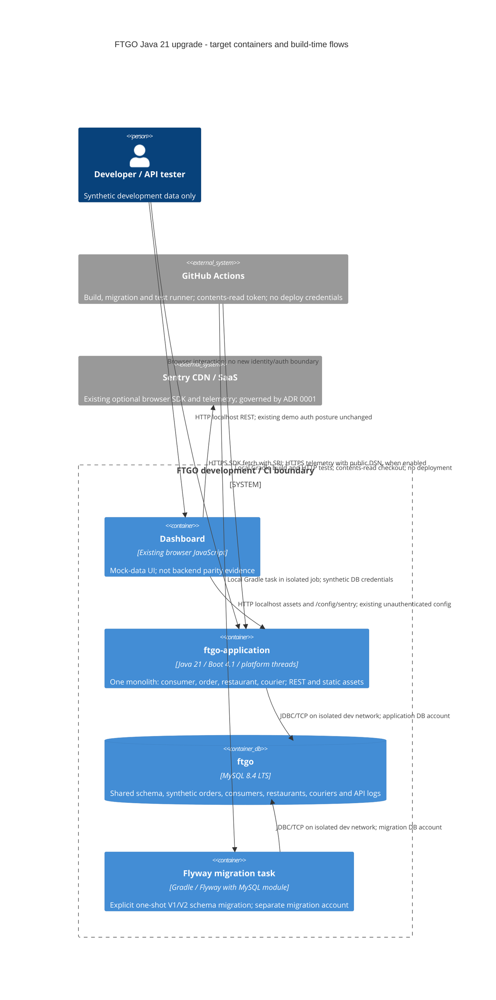

# 0002. Upgrade FTGO to Java 21 and Spring Boot 4

- **Status:** Proposed
- **Date:** 2026-11-05
- **ARB ticket:** TO BE CREATED — human files the submission; approval is not implied by this ADR.
- **Authors:** Devin, for Abhay Aggarwal
- **Owning team:** FTGO repository maintainers; accountable team and named owner TBD — confirm before ARB.
- **Related ADRs:** [0001 — Sentry browser monitoring](0001-sentry-browser-monitoring-for-dashboard.md) (unchanged, not superseded).
- **Plan:** Java 21 upgrade, s1.5; implementation of the target Boot line (s3.2) requires ARB approval.

## Context

FTGO is a multi-module Gradle **monolith**, not four independently deployed services.
The consumer, order, restaurant and courier modules run in `ftgo-application` and share MySQL.
This proposal modernizes its build/runtime while preserving domain behavior, HTTP contracts
and the existing deployment topology. This PR changes documentation only, not the running stack.

Evidence was read directly from the two still-open PR branches, not assumed to be on `master`:

| Input | Immutable source | Findings used |
| --- | --- | --- |
| Dependency inventory, [PR #386](https://github.com/COG-GTM/ftgo-monolith/pull/386) | [dependency-inventory.md at fa738776](https://github.com/COG-GTM/ftgo-monolith/blob/fa73877665fc1816b5fb2d26556765545db69cf1/docs/java21-upgrade/dependency-inventory.md) | All 17 included subprojects and buildSrc; target dependency/BOM candidates, namespace and plugin incompatibilities |
| JDK 8 baseline, [PR #387](https://github.com/COG-GTM/ftgo-monolith/pull/387) | [baseline.md at 9d03a106](https://github.com/COG-GTM/ftgo-monolith/blob/9d03a106e853271eef427e3665d81c7bdbf43b6d/docs/java21-upgrade/baseline.md) | Compile/test results, existing order failure, startup/RSS, inactive build CI |
| Current source | [`master` at 1fb9c78d](https://github.com/COG-GTM/ftgo-monolith/tree/1fb9c78da64bd0bf7a1562abc990e660f2f0c544) | `build.gradle`, `gradle.properties`, wrapper, Compose, Dockerfiles, Flyway and module builds |

Current baseline: Java 8, Gradle 4.10.2, Boot 2.0.3.RELEASE / Spring 5.0.7,
Hibernate 5.2.17, MySQL image 5.7.13, Flyway Gradle plugin 6.0.0, Springfox 2.8,
Jackson 2.9 and JUnit 4. The legacy build uses removed Gradle APIs/configurations,
JCenter/dead repository references and obsolete library pins. Inventory found
33 `javax` imports in 20 source files, including persistence, servlet and lifecycle APIs.

**The baseline is not green:** all 16 Java-bearing modules compile (Flyway is configuration-only)
and 18 unit tests pass, but two application tests and two black-box E2E tests consistently fail
at `POST /orders`. `DeliveryInformation` lacks coordinate attribute overrides for
`delivery_address_latitude/longitude`; Hibernate instead inserts nonexistent `latitude/longitude`
columns. Fix and rebaseline separately before using all-green parity as the upgrade gate.
The inventory PR's earlier test run instead hit database authentication/setup failures; these
are distinct from the baseline PR's reproduced schema failure, not conflicting successful runs.
The dashboard uses browser-seeded mock data, so rendering it alone does not verify the backend.

The baseline found CircleCI configuration but no build/test checks on the inspected commits/PRs;
security/review checks do not replace a build. Its measurements are evidence, not production SLOs.
Repository-external dependency mirror/Eventuate overrides also affect reproducibility and must
be made explicit or removed by implementation work.

**ARB triggers (plan scope):** T7 — Java 8→21 and Spring Boot 2→4 major upgrades;
T2 — MySQL 5.7→8.4 changes the existing development/CI data store. Verdict: **ARB_REQUIRED**.
Triage applies to the proposed migration, not merely this docs-only diff; the design-scope
manual path in `/arb-review:arb-triage` was used (no mechanical diff detector).

## Decision

We will use **Java 21 LTS**, **Spring Boot 4.1.x**, **MySQL 8.4 LTS** for development/CI,
and **GitHub Actions** build/test CI, with staged compatibility checkpoints, BOM-aligned
dependencies and behavior-preserving code modernization, **without virtual threads**.
The monolith, module boundaries and shared database remain; this is not a service extraction,
production database migration, new identity provider or public-network rollout.

Implementation constraints:

- Pin a stable, security-reviewed Boot 4.1 patch (inventory candidate **4.1.2**); align Boot
  plugin, BOM, starters and test modules. Recheck supported releases before implementation;
  do not use preview releases or independently force Spring/Hibernate/Jackson versions.
- Use a compatible Gradle 8.x wrapper (inventory candidate **8.14.3**, Boot 4 requires 8.14+).
  Replace `compile`/`runtime`/`testCompile` and removed custom plugin APIs before lifting the
  wrapper. Build logic must also compile under the chosen Gradle JVM. Final Java toolchains
  and compiler `--release` are **21** across Java modules; use a pinned Temurin 21 JRE image
  for the application. The unmodified Gradle 4 wrapper still runs only under JDK 8.
- Boot **2.7.18** is a short-lived `javax` bridge, not an approved release destination.
  Use supported JVM combinations at each checkpoint; its Hibernate 5.6 Java 21 support
  limitation must not be hidden by a blanket claim that every bridge dependency is certified.
  Use a Boot 3.x compatibility checkpoint if needed to diagnose migration changes, not as
  a substitute for the requested final 4.1.x line.
- At the Boot 4 checkpoint migrate relevant `javax` APIs to `jakarta`, adapt JPA mappings
  to BOM-managed Hibernate 7, port custom Jackson configuration/`Money` and date handling
  to Jackson 3, and use the Boot 4 modular web/test starters. Do not blindly rename
  Jackson annotations (which retain their supported 2.x namespace).
- Replace Springfox with Boot-4-compatible springdoc (inventory candidate **3.2.0**), use
  `/v3/api-docs`, and verify Swagger UI compatibility/redirects. Preserve business endpoints,
  trailing-slash behavior, status codes, validation and wire JSON. A docs endpoint migration
  must be documented; any additional breaking public contract requires renewed T4 review.
- Consolidate tests on JUnit Jupiter and a compatible REST Assured family; replace obsolete
  Eventuate polling utilities with a maintained polling utility while preserving assertions.
  Preserve test discovery/counts and shared test-fixture visibility; do not skip failing tests.
- Align Flyway, its MySQL support module and Connector/J with the selected stack, including
  isolated buildSrc/migration classpaths. Keep migrations as an explicit Gradle step, not
  silently move them to application startup. Validate existing V1/V2 on a fresh MySQL 8.4
  database and verify checksums; do not rewrite already-applied migrations.
- Keep platform-thread request execution; leave `spring.threads.virtual.enabled` false/unset.
  Modernize language/collection APIs where behavior is provable. Do not turn JPA entities into
  records or introduce preview features, concurrency redesign, native images or new services.
- Introduce least-privilege GitHub Actions PR builds, tests and reports. Use `contents: read`,
  SHA-pinned actions, isolated synthetic test databases and no deployment/cloud credentials.
  Use JDK 8 for the old wrapper, add JDK 21 only after the bridge/wrapper supports it, and
  finish with Java 21 as the required target; do not expect Java-21 bytecode to run on Java 8.

## Alternatives considered

| Alternative | Pros | Cons | Why rejected |
| --- | --- | --- | --- |
| Do nothing: Java 8 / Boot 2.0 / MySQL 5.7 | No immediate migration effort | Old stack, brittle dependency resolution, no reproducible build CI; existing defects remain | Does not meet the runtime/framework upgrade goal |
| Stop at Boot 2.7.18 | Smaller `javax` migration; useful staging point | Legacy framework/ORM; Java 21 support is not uniform across its graph | Bridge only, not the requested supported target |
| Stop at Boot 3.x | Jakarta transition with a smaller framework jump | Still requires namespace/ORM work and another major migration to reach the requested line | Optional diagnostic checkpoint; final choice is 4.1.x |
| Jump directly from Boot 2.0 / Gradle 4 to Boot 4 / Java 21 | Fewer temporary configurations | Build, namespace, ORM and JSON failures become difficult to isolate | Use staged, independently verified checkpoints instead |
| MySQL 8.0 as final store | Potential intermediate upgrade path; newer than 5.7 | Does not reach the selected 8.4 LTS baseline; adds a later store migration | Intermediate only when preserving an existing database requires it |
| Retain MySQL 5.7 | No local data reset | Incompatible with proposed modern ORM/Connector/J choices; legacy image/setup risk | Fresh MySQL 8.4 dev/CI store is part of the target |
| Keep CircleCI configuration only | Avoid CI migration work | No observed build/test runs; configuration presence is not validation | GitHub Actions provides the requested reproducible PR checks |
| Enable Java 21 virtual threads now | Possible concurrency benefits | Adds connection-pool, context propagation and load-testing scope unrelated to parity | Explicitly deferred; requires a separate measured proposal |

## Architecture

Target **C4 container view**; internal service modules remain components inside one application.
CI and the migration runner are build-time execution contexts, not new always-on services.

GitHub remains the existing source host; Actions adds build execution, not a new runtime vendor.
There is no new Kafka/Zipkin deployment implied by stale Compose environment variables.
No new Sentry SDK, data flow or collection setting is authorized by this upgrade.

## Non-functional requirements

Numbers below are either explicitly sourced observations or marked TBD, not invented commitments.
Unknown targets must be resolved with the owner before ARB approval.

| NFR | Target | How met / evidence required |
| --- | --- | --- |
| Availability SLO | TBD — owner to confirm before ARB; no production SLA evidenced for this demo | Existing health endpoint plus real create/revise/cancel/deliver API smoke tests; dashboard alone is insufficient |
| p95 API latency | TBD — owner to confirm workload, concurrency and regression budget before ARB | Compare identical API workload, dataset, VM, JVM flags and warm-up; baseline has no latency/load measurement |
| Startup / memory | No unexplained regression; numeric budget TBD — owner to confirm before ARB | Baseline: health 200 at 6.8s, startup RSS 1,531 MB, default host heap; do not compare with Compose's `-Xmx192m` run |
| RPO / RTO | TBD — owner to confirm recovery/loss tolerance before ARB; dev/CI fixtures are disposable | Exercise fresh bootstrap and restore on a separate database; retain old data/image until rollback is verified |
| Peak load | TBD — owner to confirm requests/sec, concurrency, dataset size and duration before ARB | Real API load test with MySQL 8.4; no production traffic figures inferred from unit tests |
| Scaling model | Retain one application deployment and one shared database | No new replicas, autoscaling, queues or virtual threads; measure connection-pool and thread behavior |
| Data retention | No new data categories; dev fixtures, API logs and CI report retention TBD — owner to confirm before ARB | Isolated synthetic fixtures; bounded CI artifacts with no secrets/customer payloads; Sentry retention remains ADR 0001's concern |
| Functional parity / reproducibility | All existing discovered tests pass after separate baseline fix; no new failures or hidden skips | Rebaseline 18 unit + 2 application + 2 E2E tests, retain assertions, test migrations, compare HTTP/JSON contracts; pin wrapper/toolchain/BOM and document external overrides |

## Security & compliance

- **Data classification:** development/CI uses synthetic data. The schema includes names,
  addresses, payment-related fields and request logs, so treat any real-data use as
  Internal/PII pending Security classification. No production/customer data may enter CI.
- **Encryption at rest:** current local Docker/MySQL configuration does not demonstrate
  database or disk encryption; no KMS key is provisioned. Use encrypted runner/host storage
  under the organization's existing controls; production encryption/key ownership is outside
  this dev-only decision and requires Security approval before any real-data deployment.
- **Encryption in transit:** existing local JDBC explicitly uses `useSSL=false`; local HTTP
  and JDBC must stay isolated/loopback-only with synthetic data. Use verified TLS for any
  non-local connection, never present the dev settings as production-compliant. GitHub,
  dependency downloads and optional Sentry telemetry use HTTPS.
- **AuthN / AuthZ:** preserve current demo behavior, not assert that it is production-grade.
  MySQL 8.4 account authentication must work with the selected driver without re-enabling
  obsolete authentication plugins. Separate app DML and migration DDL access; restrict
  Actuator/API docs to their existing intended audience. No new IdP, public ingress or
  token permission is approved here. CI token scope is read-only; no `pull_request_target`
  execution of untrusted PR code with privileged secrets.
- **Secrets:** checked-in local demo credentials are not production secrets. Keep real
  credentials out of code, logs, reports and caches; inject via approved CI secret/environment
  controls, use ephemeral test credentials and avoid secrets in fork PR jobs. Existing Sentry
  configuration remains environment-supplied; its public DSN is not a server authorization key.
- **Audit logging:** retain operational/request logs without broadening payload capture;
  verify redaction of identifiers/payment fields and restricted access/retention. No compliance
  audit trail is evidenced; required events, reviewer and retention are TBD before ARB.
- **Data residency / regions:** no runtime residency change proposed. GitHub runner location,
  artifact residency/retention and authorized operators are TBD — Security/owner must confirm
  before ARB. Sentry's existing egress and PII/replay settings remain governed by ADR 0001;
  they are not implicitly accepted for real data here.
- **Policy sections satisfied:** `arb-triggers.md` T7/T2 requires this Proposed ADR, diagram,
  NFRs, costs, owner and human-filed ARB ticket. No repository `policy/approved-infra.yaml`
  exists and no cloud/IaC resource is added; T5 is not evidenced. This is not a claim of
  production security/compliance approval. Approval and unresolved gaps remain merge gates.
- **Threats considered:** unsupported dependencies and repository supply-chain risk (BOM,
  pinned actions/images, wrapper verification, security/license checks); Java agent/reflection
  access (fix libraries, avoid blanket `--add-opens`); ORM/JSON behavior drift (contract tests);
  credential/log leakage (synthetic fixtures, redaction); data loss on store upgrade (separate
  fresh database, backups and restore rehearsal).

## Cost

| Item | Assumption | Monthly estimate |
| --- | --- | --- |
| Application + development MySQL | Same one-app/one-store footprint; no managed cloud service added; heap/CPU/storage delta unmeasured | TBD — owner to confirm utilization and host rate before ARB |
| GitHub Actions compute | Runs/month × minutes/run × billable runner rate; concurrency/OS and included private-repo allowance unknown | TBD — owner to confirm before ARB |
| CI artifacts/cache | Retained GB-month × applicable rate; retention and test-report size unknown | TBD — owner to confirm before ARB |
| Licenses/support + migration effort | Inventory does not establish support contracts, commercial Flyway use or engineering effort | TBD — owner/procurement to confirm before ARB |
| **Total incremental recurring** | No new paid vendor plan assumed; this is not a zero-cost claim | **TBD — owner to confirm before ARB; cannot yet exclude T9** |

Cost owner must record assumptions and amount before review; new recurring spend above $2,000/month
adds T9 full review (already required here), and $500–$2,000/month meets the light cost threshold.
Do not add reserved capacity or paid runner/support plans under this proposal without review.

## Operations

- **Accountable owner:** FTGO repository maintainers; named application owner, data/migration
  owner and CI owner TBD — confirm before ARB. Proposed responsibilities are application/parity,
  schema/restore and CI/toolchain respectively, not assignments accepted by other teams.
- **On-call rotation:** TBD — owner to confirm before ARB. No new team/rotation is established;
  if delivery spans independently owned teams/shared platform components, add T8 triage.
- **Runbook:** current entry points are `build-and-test-all.sh`, `run-end-to-end-tests.sh`,
  `start-services.sh` and `set-env.sh`. The upgrade documentation step must publish the verified
  Java 21 bootstrap/migration/rollback procedure under `docs/java21-upgrade/` before cutover.
  Do not execute volume-removal helpers against data that must be preserved.
- **Dashboards / alarms:** preserve health, existing Micrometer/Prometheus instrumentation and
  optional browser Sentry. Before cutover verify endpoint exposure and metrics behavior;
  alert thresholds, recipients and CI failure ownership are TBD before ARB.
- **Rollback plan:** retain tagged old source/artifacts, JDK/image and a validated pre-upgrade
  database backup in a separate environment. For disposable dev/CI data, rebuild the old store
  from old migrations/fixtures; for retained data, restore the old backup with the old stack.
  Never run MySQL 5.7 against an upgraded 8.4 data directory or assume ORM/schema downgrade
  compatibility. Reverting application code alone is not database rollback. No production
  cutover is authorized by this ADR.
- **Migration / cut-over plan:** (1) repair/rebaseline the existing order mapping; establish CI;
  (2) port Gradle APIs/custom plugins and reach the Boot 2.7 bridge / Gradle 8 checkpoint;
  (3) obtain human-filed ARB approval before the target Boot migration, then coordinate Jakarta,
  ORM/JSON, API docs, tests and database/driver changes as tested checkpoints; (4) enforce Java
  21 release/toolchains/images and modernize code without virtual threads; (5) verify full API,
  migration and performance parity plus recovery, then update scripts/docs/environment.

For dev/CI, use a **fresh, separate MySQL 8.4 database** and synthetic fixtures; do not point
8.4 at the old 5.7 volume. If existing data must be retained, stop and plan a supported staged
5.7→8.0→8.4 migration with version-specific checks, backups, reconciliation and restore testing.
MySQL does not support skipping the intervening release series for an in-place upgrade;
see [MySQL 8.4 upgrade paths](https://dev.mysql.com/doc/refman/8.4/en/upgrade-paths.html).
Validate V1/V2 migrations, SQL modes, character sets/collations, authentication, generated IDs,
JPA column mappings and application reads/writes on 8.4 before switching local defaults.

## Policy exceptions requested

| Rule | Resource | Justification | Compensating control | Expiry |
| --- | --- | --- | --- | --- |
| none requested | N/A — no unapproved cloud resource proposed | N/A | N/A | N/A |

No exception is presumed for unknown ownership, NFRs, cost or security controls. Resolve the gaps
with ARB; if a real exception is needed, add its rule, scope, control, owner and expiry for approval.

## Consequences

- **Positive:** one modern Java/Boot baseline, reproducible PR validation, fewer obsolete libraries,
  explicit migration ownership and safer, observable dependency/runtime maintenance.
- **Negative / risks:** large compatibility surface (Gradle, Jakarta, Hibernate 7, Jackson 3,
  springdoc and tests); temporary bridge maintenance; MySQL authentication/schema changes;
  baseline defect and environment overrides can obscure regressions; target support must be rechecked.
- **Follow-ups:** record exact approved versions and support window, close the baseline mapping
  defect, supply missing NFR/cost/security/ownership answers, implement checkpoint tests and runbooks.

## Open questions

1. Who are the accountable application, migration/data and CI owners, on-call and escalation contacts?
2. What availability, p95 latency, peak workload, startup/RSS regression budgets, RPO and RTO are approved?
3. Are all environments strictly synthetic/disposable, and what fixture/API log/CI artifact retention,
   residency, audit and encryption controls must apply? Who owns the inherited Sentry privacy decision?
4. What Actions allowance/rates, run frequency, artifact volume, host costs and commercial support
   obligations apply; what is the measured incremental recurring cost and migration effort?
5. Which stable Boot 4.1 patch, Java 21 distribution/image digest, MySQL 8.4 patch/image and dependency
   set are approved at implementation time, and who owns their patch/support lifecycle?
6. Has the human filed the ARB submission and linked its real ID and approval? Replace
   `TO BE CREATED` in this ADR and the PR's Architecture review section; do not invent an ARB ID,
   mark this ADR Accepted, merge the architecture PR or unblock phase 3 based on a draft alone.
