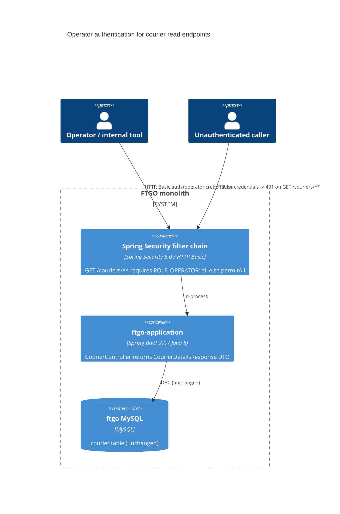

# 0002. Operator authentication for courier read endpoints

- **Status:** Proposed
- **Date:** 2026-11-05
- **ARB ticket:** TO BE CREATED
- **Authors:** Devin (code scan remediation, finding sfind-f5f468adf67842fabde0fc0c247f0412)
- **Owning team:** TBD — owner to confirm before ARB
- **Related ADRs:** [0001](0001-sentry-browser-monitoring-for-dashboard.md) (unrelated; first ADR in repo)

## Context

`GET /couriers/{courierId}` returned the `Courier` JPA entity (name, home address with coordinates,
live latitude/longitude, last location update) and `GET /couriers/{courierId}/workload` returned the live
position, both to any unauthenticated caller. Courier IDs are sequential, so an attacker could enumerate
every courier's identity, home address and real-time location. The monolith had no authentication layer
at all.

Constraints: the rest of the API (orders, consumers, restaurants, courier writes) is unauthenticated and
used by the end-to-end tests; the dashboard uses mock data and never calls the API. There is no courier
identity/credential store, so per-courier self-service access cannot be implemented without a schema
change.

ARB triggers: T6 (authentication/authorization change — introduces Spring Security and HTTP Basic auth
for an API surface).

## Decision

We will add `spring-boot-starter-security` to `ftgo-application` with a stateless HTTP Basic configuration
(`SecurityConfiguration`) that requires `ROLE_OPERATOR` for `GET /couriers/**` and leaves every other
request unchanged (`permitAll`). The single operator account is configured through
`FTGO_OPERATOR_USERNAME` / `FTGO_OPERATOR_PASSWORD`; with no password set, no account exists and the
courier read endpoints are unreachable (fail closed). `GET /couriers/{id}` now returns a
`CourierDetailsResponse` DTO instead of the entity, and unknown courier IDs return 404 instead of 500.

## Alternatives considered

| Alternative | Pros | Cons | Why rejected |
| --- | --- | --- | --- |
| Do nothing | No change | Every courier's home address and live GPS stays publicly enumerable | Unacceptable privacy/safety exposure |
| Redact address/coordinates for everyone, no auth | No auth infrastructure | Operators lose the data they need; name and plan still enumerable | Breaks the legitimate operator use case and does not stop enumeration |
| Secure the whole API now | Closes all IDOR-style gaps at once | Breaks every client and test that calls orders/consumers/restaurants; much larger blast radius | Out of scope for this finding; tracked as follow-up |
| Courier self-service login (courier sees own record) | Matches least-privilege recommendation | Needs a credential store (schema migration) and onboarding flow | Deferred; operator-only access is strictly more restrictive in the meantime |

## Architecture

## Non-functional requirements

| NFR | Target | How met |
| --- | --- | --- |
| Availability SLO | Unchanged | In-process filter chain, no new dependency at runtime |
| p95 latency | Negligible change (one password hash check per protected request) | BCrypt via delegating encoder; only on `GET /couriers/**` |
| RPO / RTO | N/A — no new data store | |
| Peak load | TBD — owner to confirm before ARB | |
| Scaling model | Stateless (no HTTP session) | `SessionCreationPolicy.STATELESS` |
| Data retention | N/A | |

## Security & compliance

- **Data classification:** courier name, home address, live location — PII; now restricted to operators.
- **Encryption at rest:** N/A — no change.
- **Encryption in transit:** HTTP Basic sends credentials in every request; TLS must terminate in front of the app in any non-local deployment (TBD — owner to confirm ingress).
- **AuthN / AuthZ:** HTTP Basic, in-memory single operator account, `ROLE_OPERATOR` on `GET /couriers/**`; 401 unauthenticated, 403 wrong role.
- **Secrets:** operator password from `FTGO_OPERATOR_PASSWORD` env var; never committed; no default value.
- **Audit logging:** none added — TBD.
- **Data residency / regions:** N/A.
- **Policy sections satisfied:** no `policy/approved-infra.yaml` in this repo; no infrastructure added.
- **Threats considered:** ID enumeration of courier PII (closed: auth checked before lookup, so unknown vs known IDs are indistinguishable without credentials); entity over-serialization (closed: explicit DTO, order not exposed); credential brute force (not rate-limited — follow-up).

## Cost

| Item | Assumption | Monthly estimate |
| --- | --- | --- |
| None | Library dependency only | $0 |
| **Total** | | $0 |

## Operations

- **On-call rotation:** TBD — owner to confirm before ARB.
- **Runbook:** set `FTGO_OPERATOR_PASSWORD` (and optionally `FTGO_OPERATOR_USERNAME`, default `operator`) before starting the JAR / docker-compose; without it, courier reads return 401.
- **Dashboards / alarms:** none.
- **Rollback plan:** revert the PR.
- **Migration / cut-over plan:** any client of `GET /couriers/{id}` or `/workload` must send operator credentials; response for `GET /couriers/{id}` is now `CourierDetailsResponse` (`courierId` instead of `id`, actions carry `type`/`time` only).

## Policy exceptions requested

| Rule | Resource | Justification | Compensating control | Expiry |
| --- | --- | --- | --- | --- |
| none | | | | |

## Consequences

- Positive: courier PII and live location are no longer publicly enumerable; unknown IDs return 404.
- Negative / risks: single shared operator credential; Basic auth requires TLS in production.
- Follow-ups: courier self-service credentials; authorization for courier write endpoints (`POST /couriers/{id}/location`, `/availability`) and the rest of the API; move to a real IdP/OIDC; rate limiting.

## Open questions

- Owning team, on-call, ingress/TLS termination and peak load (see TBDs above).
- Whether operators need the home address at all, or it should be dropped from the DTO.
