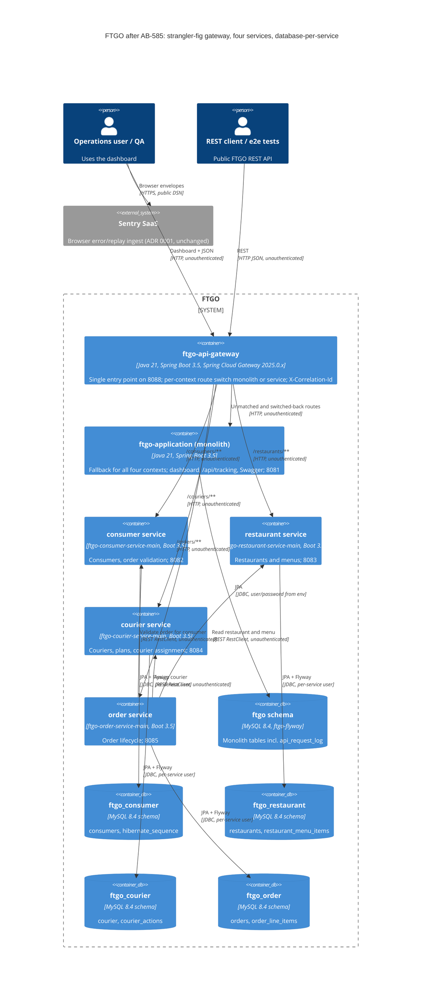

# 0003. Strangler-fig decomposition of ftgo-monolith into four services behind an API gateway, database-per-service

- **Status:** Proposed
- **Date:** 2026-11-12
- **ARB ticket:** TO BE CREATED (no ARB Jira project exists yet; submission body in [docs/microservices/arb-submission.md](../microservices/arb-submission.md))
- **Jira:** [AB-586](https://cog-gtm.atlassian.net/browse/AB-586) (epic [AB-585](https://cog-gtm.atlassian.net/browse/AB-585))
- **Authors:** Devin (for Abhay Aggarwal)
- **Owning team:** TBD — owner to confirm before ARB (requester: Abhay Aggarwal)
- **Related ADRs:** [0001 Sentry browser monitoring](0001-sentry-browser-monitoring-for-dashboard.md) (dashboard keeps being served by the monolith, unchanged); [0002 Java 21 / Spring Boot 3.5](0002-java-21-spring-boot-3.md) (baseline this epic builds on; still on the `devin/ab-561-java21` integration branch). Detailed decomposition (context map, data ownership, routes, ports): [docs/microservices/README.md](../microservices/README.md).

## Context

`ftgo-monolith` is one Spring Boot 3.5 / Java 21 application (`ftgo-application`) that serves the FTGO REST API, the
operations dashboard and Swagger UI from a single jar and a single MySQL schema (`ftgo`, Flyway V1 + V2 in
`ftgo-flyway`). The code is already split into `ftgo-{consumer,restaurant,courier,order}-service` Gradle modules with
`-api` contract modules, but those modules are libraries, not services:

- `FtgoApplicationMain` imports all four service configurations into one Spring context, one jar, one schema.
- All entities live in the shared `ftgo-domain` module and are scanned by one `DomainConfiguration`
  (`@EntityScan` + `@EnableJpaRepositories` over the whole package).
- Three JPA relationships cross aggregate boundaries, each backed by a V1 foreign key:
  `Order.restaurant` (`@ManyToOne Restaurant`, FK `orders_restaurant_id`),
  `Order.assignedCourier` (`@ManyToOne Courier`, FK `orders_assigned_courier_id`) and
  `Courier.plan.actions[].order` (`Action.order`, `@ManyToOne Order`, FK `courier_actions_order_id`) — so Order and
  Courier reference each other cyclically.
- `OrderService` reads `RestaurantRepository` directly, calls `ConsumerService.validateOrderForConsumer` in-process,
  and in `scheduleDelivery` queries `CourierRepository.findAllAvailable()`, runs
  `DistanceOptimizedCourierAssignmentStrategy` and mutates `Courier.plan` in the same transaction.
- `ftgo-order-service` has a Gradle `api` dependency on `ftgo-consumer-service` (an implementation module).
- E2E tests hard-code `http://$DOCKER_HOST_IP:8081`.

The goal of epic AB-585 is independently deployable consumer, restaurant, courier and order services behind an API
gateway, extracted with the strangler-fig pattern: the monolith keeps running unchanged, and traffic moves to a
service one route group at a time with a configuration switch that can be flipped back at any time. Hard constraint:
the public REST paths and JSON shapes do not change (the AB-563 golden JSON and the e2e suite are the oracle),
whichever side serves a route.

ARB triggers: **T1** (five new deployables), **T2** (four new schemas and data moved between schemas),
**T4** (new synchronous service-to-service contracts between bounded contexts), **T6** (new network boundary:
gateway in front of the monolith, new listening ports, unauthenticated service-to-service HTTP),
**T7** (framework introduction: Spring Cloud 2025.0.x / Spring Cloud Gateway) and **T8** (new shared platform
library `ftgo-service-runtime`). See [ARB triage](#arb-triage).

## Decision

We will decompose ftgo-monolith with the strangler-fig pattern into four Spring Boot deployables —
`ftgo-consumer-service-main`, `ftgo-restaurant-service-main`, `ftgo-courier-service-main`, `ftgo-order-service-main` —
behind a Spring Cloud Gateway (`ftgo-api-gateway`) that routes each context to either the monolith or its service via a
per-context switch (default `monolith`). Each service owns its own MySQL schema (`ftgo_<context>`) on the same MySQL
8.4 server with its own DB user and Flyway migrations, references other aggregates by id only, and talks to other
services over synchronous REST behind ports with an in-process (monolith) and a remote (service) adapter. The
existing `ftgo-*-service` library modules keep the business code and stay on the monolith classpath, so the monolith
remains a complete, working fallback until each context is cut over in the order consumer → restaurant → courier →
order. Asynchronous messaging, service-to-service authentication and Kubernetes packaging are follow-up epics.

### Target architecture (epic AB-585 decisions)

| Concern | Decision |
| --- | --- |
| Deployables | New Boot app modules `ftgo-consumer-service-main`, `ftgo-restaurant-service-main`, `ftgo-courier-service-main`, `ftgo-order-service-main`, `ftgo-api-gateway` (skeletons in AB-587). Existing `ftgo-*-service` library modules keep the business code and stay on the monolith's classpath. |
| Ports (host) | monolith 8081 (unchanged), gateway 8088, consumer 8082, restaurant 8083, courier 8084, order 8085. Containers listen on 8080. |
| Data | Database-per-service: schemas `ftgo_consumer`, `ftgo_restaurant`, `ftgo_courier`, `ftgo_order` on the same MySQL 8.4 server, one DB user per service granted only its schema. Each service owns its Flyway migrations (`classpath:db/<context>/migration`) and runs them on startup. Monolith `ftgo` schema and `ftgo-flyway` are unchanged except for additive, backward-compatible migrations. |
| Cross-service references | By id only. No JPA relationship crosses an aggregate owned by another service; no cross-schema FKs. |
| Integration | Synchronous REST (Spring `RestClient` / HTTP interfaces) behind ports in the calling module, with two adapters: in-process (default, monolith) and remote (property-selected, `ftgo.integration.<context>=in-process\|remote`). Messaging/outbox is a follow-up epic. |
| Gateway | Spring Cloud Gateway (Spring Cloud 2025.0.x, the Boot 3.5-compatible release train; AB-587 pins the patch after checking the Spring Cloud compatibility table). Per-context switch `ftgo.routing.<context>=monolith\|service`, default `monolith`; everything unmatched (`/`, dashboard static files, `/api/tracking/**`, Swagger) goes to the monolith. |
| Contract | Public REST paths and JSON shapes do not change (AB-563 golden JSON + e2e suite are the oracle), whether a route is served by the monolith or a service. |
| Cross-cutting | Shared `ftgo-service-runtime` library: actuator health/info/prometheus, `X-Correlation-Id` propagation in/out (`RestClient` interceptor), the Boot 2.0-compatible `/error` body and Jackson date settings the monolith already uses. |
| Security | Gateway and service-to-service traffic stay unauthenticated, matching today's monolith. Accepted as an interim state and recorded as an ARB follow-up; no auth is added in this epic. |

## Alternatives considered

| Alternative | Pros | Cons | Why rejected |
| --- | --- | --- | --- |
| Do nothing / stay a modular monolith (tighten module boundaries only, e.g. split `ftgo-domain` per context, ArchUnit rules) | No new deployables, no network hops, no distributed data; lowest cost and risk | Contexts still release, scale and fail together; one schema keeps the FK coupling; does not deliver the epic goal (independent deployability) or the reference-architecture demo | Kept as the **fallback state**: every wave leaves the monolith fully working, so stopping after any wave degrades to an improved modular monolith. Not the target |
| Big-bang rewrite (new services built from scratch, one switch-over) | Clean design unconstrained by the existing model | Long period with two diverging code bases; one high-risk cut-over with no incremental rollback; parity is hard to prove | Strangler-fig with per-context switches gives incremental, reversible cut-overs and reuses the tested business code |
| Services sharing the existing `ftgo` database | No data migration; cross-context joins and FKs keep working; simplest cut-over | Schema becomes a hidden shared contract; services cannot evolve or migrate their tables independently; one DB user with access to everything; FKs keep Order/Courier/Restaurant coupled at the storage layer | Violates the database-per-service decision; independent deployability would be nominal only. Same MySQL **server** is kept (separate schemas + users) to limit cost |
| Async-first with Kafka / Eventuate Tram (sagas, CQRS views; the upstream `microservices-patterns/ftgo-application` design) | Loose temporal coupling; resilience to downstream outages; natural fit for order → courier assignment | Adds a broker (Kafka + ZooKeeper/KRaft), Eventuate CDC and outbox tables — new infrastructure and vendor (T3/T5) on top of the split; every flow becomes eventually consistent, so the synchronous REST contract and golden JSON (e.g. `assignedCourier` set on `POST /orders/{id}/accept`) would change | Deferred to a **follow-up epic**. Ports/adapters introduced here are the seam where async adapters can be added later without touching domain code |
| **Strangler-fig, sync REST, database-per-service on one MySQL server, Spring Cloud Gateway (chosen)** | Incremental and reversible per context; contract unchanged; reuses existing modules; minimal new infrastructure (no broker, same MySQL server) | Network hops add latency and partial-failure modes; synchronous coupling (order service depends on consumer, restaurant, courier being up); data copy and per-context write freeze at cut-over; temporary duplication (code in monolith and service) | Best fit for an incremental, demonstrable extraction with an always-available rollback |

## Architecture

Target state with every route switched to its service (`ftgo.routing.*=service`, `ftgo.integration.*=remote`). In
the default all-monolith mode every gateway route points at `ftgo-application` instead.



All five schemas live on the **same MySQL 8.4 server**; isolation is by schema and DB user, not by server. The
monolith keeps using only the `ftgo` schema. While a context is on the monolith its service may run but receives no
gateway traffic; data is copied into the service schema at that context's cut-over (AB-595).

## Non-functional requirements

| NFR | Target | How met |
| --- | --- | --- |
| Functional parity | Empty diff against the AB-563 golden JSON and a green e2e suite in three modes: monolith direct (8081), gateway all-monolith, gateway all-services | AB-594 CI matrix; AB-595 parity report |
| Availability SLO | TBD — owner to confirm before ARB (demo application; no SLO today) | Every container has an actuator health check; rollback per context is a gateway switch flip |
| p95 latency | Gateway adds one HTTP hop (and order → consumer/restaurant/courier add up to three on create/accept); absolute target TBD — owner to confirm before ARB | p50/p95 monolith vs gateway measured with `docs/upgrade/java21/load-test.py` in AB-595 |
| Downstream call timeouts | Bounded connect/read timeouts on every `RestClient` adapter; values set and justified in AB-592 | Errors map to the existing exceptions (`RestaurantNotFoundException`, etc.) so HTTP status codes do not change |
| RPO / RTO | Cut-over: RPO 0 per context (writes frozen for that context during the copy; counts/checksums verified). RTO for a rollback = time to flip the gateway switch and restart the gateway (target minutes; TBD — owner to confirm) | AB-595 migration scripts and runbook, rehearsed on the compose topology |
| Peak load | TBD — owner to confirm before ARB | Unchanged business load; services stateless |
| Scaling model | Each service stateless and independently scalable; single MySQL server shared (vertical) | Compose locally (AB-593); k8s/Helm is a follow-up (relates to AB-402) |
| Memory | Each JVM container gets a memory limit like the monolith (512 MiB, `-XX:MaxRAMPercentage=75`) | AB-587 Dockerfiles, AB-593 compose |
| Data retention | Unchanged; `api_request_log` stays in the monolith schema | — |

## Security & compliance

- **Data classification:** unchanged — demo data. `consumers` and `courier` hold person names, `courier`,
  `restaurants` and `orders` hold addresses and coordinates (PII-adjacent), `orders.payment_token` holds a payment token
  column. No new data categories; data is copied between schemas on the same server, never to a new location.
- **Encryption at rest:** unchanged (MySQL container volume; no KMS in this repo).
- **Encryption in transit:** unchanged — plain HTTP between gateway, services and monolith inside the compose
  network. JDBC: new services follow the compose URL pattern (no `useSSL` flag, Connector/J default `PREFERRED`); the
  local-run default in `ftgo-application/src/main/resources/application.properties` keeps `useSSL=false`. Enforced TLS
  (HTTP and JDBC) is a follow-up together with authentication.
- **AuthN / AuthZ:** **unauthenticated, as today** — the monolith API has no authentication, and the gateway and
  service-to-service calls stay unauthenticated in this epic. Accepted as an **interim** risk, recorded as an ARB
  follow-up (gateway authentication + service-to-service identity, e.g. OAuth2 client credentials or mTLS). New
  internal-only endpoints (`POST /consumers/{consumerId}/validate-order` from AB-588, `POST /couriers/assignments` from
  AB-590) fall under the same `/consumers/**` and `/couriers/**` gateway prefixes and are therefore reachable through the
  gateway; the follow-up must either block them at the gateway or require service identity.
- **Network boundary:** new listening ports 8082–8085 (services) and 8088 (gateway). The gateway is the intended single
  entry point; services and the monolith remain directly reachable on their host ports for local development and
  rollback. Any non-local deployment must expose only the gateway (follow-up with Helm/k8s NetworkPolicy).
- **Least privilege (improvement):** one MySQL user per service with privileges on its own schema only (AB-587),
  replacing a single user that can read and write every table.
- **Secrets:** per-service DB credentials come from environment variables / the git-ignored local `.env` pattern; none
  committed. No new external secrets.
- **Audit logging:** `api_request_log` (monolith `ApiTrackingInterceptor`) only records requests served by the
  monolith; requests served by a service are not written there. Accepted gap; follow-up for gateway-level request
  tracking. Correlation ids (`X-Correlation-Id`) are propagated end-to-end by `ftgo-service-runtime`.
- **Data residency / regions:** unchanged (local compose; no cloud resources).
- **Policy sections satisfied:** no `policy/approved-infra.yaml` in this repo and no cloud infrastructure (CDK,
  Terraform, CloudFormation) is added; T5 not triggered.
- **Threats considered:** lateral movement between services (mitigated by per-schema DB users; HTTP still open —
  follow-up); exposure of internal endpoints through the gateway (see AuthN/AuthZ); request smuggling / path
  normalisation differences between gateway and monolith (gateway tests cover trailing slashes and path preservation,
  AB-591); partial failures leaving an order without courier assignment (synchronous call inside the accept request;
  error surfaces to the caller as today's `NoCourierAvailableException` path).

## Cost

| Item | Assumption | Monthly estimate |
| --- | --- | --- |
| Runtime infrastructure | Local Docker Compose on existing dev/CI hosts; five extra JVM containers (~512 MiB limit each) on the same host; same MySQL server | $0 new cloud spend |
| CI | GitHub Actions within the org's existing plan; AB-594 adds a per-service build matrix and two e2e topology jobs (more runner minutes) | $0 expected (TBD — confirm plan minutes) |
| Licences | Spring Boot, Spring Cloud Gateway, Flyway Community, MySQL Community are open source | $0 |
| **Total** | | **$0 new recurring spend expected** (below the $2k/month T9 threshold). A hosted deployment would be costed in the Helm/k8s follow-up |

## Operations

- **On-call rotation:** TBD — owner to confirm before ARB (none defined for this demo app).
- **Runbook:** `docs/microservices/cutover-runbook.md` (AB-595: per-context cut-over and rollback with commands);
  `docs/microservices/local-dev.md` (AB-593: topology, ports, troubleshooting); per-service docs
  `docs/microservices/{consumer-service,restaurant-service,courier-service,gateway}.md` (AB-588–AB-591).
- **Dashboards / alarms:** `/actuator/health` and `/actuator/prometheus` on every deployable (`ftgo-service-runtime`);
  the gateway exposes the effective route target per context (AB-591). No alerting exists today; TBD with the owner.
- **Rollback plan:** per context, set `ftgo.routing.<context>=monolith` (and `ftgo.integration.<context>=in-process`
  in the monolith) and restart the gateway — no code change. Writes made in the service schema since cut-over are
  reverse-copied into `ftgo` (AB-595 scripts). Whole-epic rollback: route everything to the monolith; the `ftgo`
  schema is only changed additively, so the pre-epic monolith still runs against it.
- **Migration / cut-over plan:** Wave 0 AB-586 (this ADR) + AB-587 (scaffolding) → Wave 1 AB-588 consumer, AB-589
  restaurant, AB-590 courier, AB-591 gateway → Wave 2 AB-592 order → Wave 3 AB-593 compose topology, AB-594 CI/e2e →
  Wave 4 AB-595 data migration, cut-over/rollback rehearsal, parity sign-off. Cut-over order: consumer → restaurant →
  courier → order (leaf contexts first; order last because it depends on the other three).

## Policy exceptions requested

| Rule | Resource | Justification | Compensating control | Expiry |
| --- | --- | --- | --- | --- |
| none | | | | |

## ARB triage

Run by hand against `rules/arb-triggers.md` on the planned change set of epic AB-585 (this PR only adds documentation;
the detector script is blocked by the org guardrails).

```
ARB triage: ARB_REQUIRED
Triggers:
- T1 New deployable services: ftgo-consumer-service-main, ftgo-restaurant-service-main, ftgo-courier-service-main, ftgo-order-service-main, ftgo-api-gateway (AB-587..AB-592)
- T2 New data stores: schemas ftgo_consumer, ftgo_restaurant, ftgo_courier, ftgo_order with per-service users and Flyway histories; data copied out of ftgo (AB-588..AB-592, AB-595). Classification unchanged
- T4 New sync cross-domain contracts: order -> consumer validate-order, order -> restaurant menu read model, order -> courier assignment (AB-588..AB-590, AB-592); cross-aggregate FKs removed from service schemas
- T6 Network boundary change: gateway becomes the front door (8088), new service ports 8082-8085, unauthenticated service-to-service HTTP (accepted interim, follow-up)
- T7 Framework introduction: Spring Cloud 2025.0.x / Spring Cloud Gateway (AB-587, AB-591)
- T8 New shared platform library: ftgo-service-runtime used by all five deployables (AB-587)
Not triggered: T3 (no external vendor/SaaS; Spring Cloud and Flyway are libraries; Sentry unchanged), T5 (no cloud infrastructure; no approved-infra policy in repo), T9 ($0 new recurring spend)
Required next steps: ADR (this file), ARB ticket (TO BE CREATED), C4 diagram (above), NFRs, cost estimate; epic PR to the default branch waits on ARB approval
```

## Consequences

- Positive: each context can be built, deployed, scaled and rolled back independently; storage-level coupling
  (cross-context FKs, one shared DB user) is removed; the monolith stays a working fallback during the whole
  migration; ports/adapters give a seam for async messaging later.
- Negative / risks: more moving parts (six JVMs + gateway hop) to run and observe; synchronous coupling means the
  order service fails when consumer/restaurant/courier is down (no circuit breaker in this epic); duplicated code paths
  (monolith and service) until the retirement follow-up; data copy and short per-context write freeze at cut-over;
  `GetOrderResponse.restaurantName` needs a denormalised snapshot in `orders` (additive V3 migration, AB-592);
  unauthenticated internal endpoints are reachable through the gateway (interim); `api_request_log` no longer sees
  service-served traffic.
- Follow-ups (filed by AB-595): async messaging / transactional outbox; gateway and service-to-service authentication
  (incl. hiding internal endpoints); Helm/Kubernetes packaging (relates to AB-402); retiring service code from
  `ftgo-application`; moving the remaining entities out of `ftgo-domain`; gateway-level request tracking to replace
  `api_request_log` for service traffic; separate MySQL servers per service if isolation or scaling requires it.

## Open questions

- Owning team, on-call rotation, availability SLO, p95 latency target, rollback RTO and peak load: TBD — owner to
  confirm before ARB.
- Gateway flavour (`spring-cloud-starter-gateway-server-webmvc` vs the WebFlux starter): decided and justified in AB-587.
- Whether ARB wants the internal endpoints blocked at the gateway in this epic rather than in the auth follow-up.
- Whether the shared MySQL server is acceptable beyond local/demo use, or a server per service is required before a
  hosted deployment.
