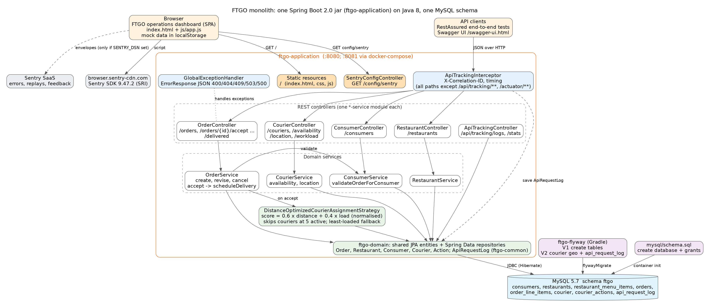

# FTGO monolith architecture

This describes what the code on `master` does today. The diagram source is
[`diagrams/architecture.dot`](diagrams/architecture.dot) (Graphviz); re-render the
PNG and SVG with [`diagrams/render.sh`](diagrams/render.sh) after editing it.



## Runtime

FTGO (Food To Go) runs as **one Spring Boot 2.0.3 process** (`ftgo-application`, Java 8) backed by
**one MySQL 5.7 schema** (`ftgo`). `FtgoApplicationMain` imports the consumer, order, restaurant
and courier web configurations plus `ApiTrackingConfiguration`, so every business capability
shares the same JVM, transaction manager and database. There is no messaging, no Eventuate
runtime and no other service.

| Port | When |
|------|------|
| 8080 | `java -jar ftgo-application/build/libs/ftgo-application.jar` |
| 8081 | `docker-compose up` (container port 8080 mapped to host 8081) |

The same process serves:

- the REST API (below), with Swagger UI at `/swagger-ui.html` (`common-swagger`, springfox 2.8);
- Spring Boot Actuator at `/actuator/**` (e.g. `/actuator/health`, used by the Docker healthcheck);
- the operations dashboard, static files from `ftgo-application/src/main/resources/static`.

## Gradle modules

| Module | Role |
|--------|------|
| `ftgo-application` | Boot main class, `GlobalExceptionHandler`, `SentryConfigController`, static dashboard, Dockerfile |
| `ftgo-order-service` (+ `-api`) | `OrderController`, `OrderService` (create, revise, cancel, accept → schedule delivery, state changes), Micrometer counters |
| `ftgo-consumer-service` (+ `-api`) | `ConsumerController`, `ConsumerService.validateOrderForConsumer` |
| `ftgo-restaurant-service` (+ `-api`) | `RestaurantController`, `RestaurantService` (restaurants and their menus) |
| `ftgo-courier-service` (+ `-api`) | `CourierController`, `CourierService` (availability, location, workload) |
| `ftgo-domain` | Shared JPA entities and Spring Data repositories: `Order`, `Restaurant`, `Consumer`, `Courier`, `Action`, `Plan`; courier assignment strategies |
| `ftgo-common` | `Money`, `Address`, `PersonName`, JSON config, API request tracking (`ApiTrackingInterceptor`, `ApiRequestLog`, `ApiTrackingController`) |
| `ftgo-common-jpa`, `common-swagger`, `ftgo-test-util` | JPA mapping helpers, Swagger config, test helpers |
| `ftgo-flyway` | Flyway Gradle plugin and migrations `V1__create_ftgo_db.sql`, `V2__add_courier_optimization_and_api_tracking.sql` |
| `ftgo-end-to-end-tests-common`, `ftgo-end-to-end-tests` | RestAssured scenarios (`AbstractEndToEndTests`) run in-process by `FtgoApplicationTest` and against a running app by `ftgo-end-to-end-tests` |

The `*-api` modules hold request/response DTOs. Service modules call each other directly as
Spring beans (for example `OrderService` → `ConsumerService`), and all of them read and write the
shared `ftgo-domain` entities.

## REST API

| Resource | Endpoints |
|----------|-----------|
| Consumers | `POST /consumers`, `GET /consumers/{consumerId}` |
| Restaurants | `POST /restaurants`, `GET /restaurants/{restaurantId}` |
| Orders | `POST /orders`, `GET /orders?consumerId=`, `GET /orders/{orderId}`, `POST /orders/{orderId}/cancel`, `/revise`, `/accept`, `/preparing`, `/ready`, `/pickedup`, `/delivered` |
| Couriers | `POST /couriers`, `GET /couriers/{courierId}`, `POST /couriers/{courierId}/availability`, `POST /couriers/{courierId}/location`, `GET /couriers/{courierId}/workload` |
| API tracking | `GET /api/tracking/logs`, `/logs/errors`, `/logs/search`, `/logs/{correlationId}`, `/stats` |
| Dashboard config | `GET /config/sentry` |

`GlobalExceptionHandler` turns exceptions into an `ErrorResponse` JSON body that carries the
request's correlation ID: not-found errors → 404, `UnsupportedStateTransitionException` → 409,
no courier available → 503, `IllegalArgumentException` → 400, anything else → 500.

## Order lifecycle and courier assignment

```
APPROVED → ACCEPTED → PREPARING → READY_FOR_PICKUP → PICKED_UP → DELIVERED
    └──────────────→ CANCELLED
```

Cancel and revise are only allowed while the order is `APPROVED`; any other out-of-order
transition throws `UnsupportedStateTransitionException` (HTTP 409).

`POST /orders` looks up the restaurant's menu items, builds line items, has `ConsumerService`
validate the consumer and saves the order as `APPROVED` (payment is not implemented; the code has
a `TODO - charge a credit card`). Accepting an order (`/accept` with a ready-by time) schedules
delivery through `DistanceOptimizedCourierAssignmentStrategy`:

- If the restaurant has no coordinates, it picks the least-loaded available courier.
- Otherwise it skips couriers with 5 or more active deliveries and scores the rest, lowest wins:
  `0.6 × min(distanceKm / 20, 1) + 0.4 × activeDeliveries / 5`, with Haversine distance from the
  courier's current location to the restaurant. A courier without a location scores
  `0.5 + 0.4 × activeDeliveries / 5`.
- If every courier is at 5 deliveries, it falls back to the least-loaded one anyway.
- With no available courier at all the call fails with 503.

`OrderService` then records `PICKUP` and `DROPOFF` actions on the courier's plan and assigns the
courier to the order. The drop-off ETA is the later of the ready-by time and the courier's arrival
at the restaurant (5 min + 2 min per km), plus 15 min, or ready-by + 30 min when coordinates are
missing.

## API request tracking

`ApiTrackingInterceptor` runs on every request except `/api/tracking/**` and `/actuator/**`. It
reuses the `X-Correlation-ID` request header or generates one, puts it in the logging MDC and the
response header, and after completion saves an `ApiRequestLog` row (method, URI, query, status,
duration, client IP, user agent, error) to the `api_request_log` table. A failure to save is only
logged. `ApiTrackingController` exposes searches and aggregate stats over that table.

## Persistence

Hibernate maps the `ftgo-domain` entities to the `ftgo` schema (`spring.jpa.generate-ddl=false`,
so the schema must exist first):

1. `mysql/schema.sql` (copied into the `mysql` image) creates the `ftgo` database and grants
   `mysqluser` access.
2. `./gradlew :ftgo-flyway:flywayMigrate` (as `root`/`rootpassword` on `$DOCKER_HOST_IP:3306`)
   creates the tables (`V1`) and adds courier/restaurant/order coordinates plus
   `api_request_log` (`V2`).

The app connects with `spring.datasource.*` from `application.properties`
(`jdbc:mysql://${DOCKER_HOST_IP:localhost}/ftgo`, `mysqluser`/`mysqlpw`), overridden by the
`SPRING_DATASOURCE_*` variables in `docker-compose.yml`.

## Operations dashboard (browser)

`index.html`, `css/style.css` and `js/app.js` form a vanilla-JS single-page app with a hash
router (`#/`, `#/orders`, `#/orders/{id}`, `#/restaurants`, `#/consumers`, `#/couriers`). It shows
an order pipeline, order lists and details, and per-entity actions such as courier availability.
The create buttons call `openModal`, which adds the class `modal-open` to the backdrop, but
`style.css` only shows `.modal-backdrop.active`, so the create forms never appear.

**The dashboard does not call the REST API.** Its `api` object is a mock that seeds sample data
and keeps all state in browser `localStorage` (key `ftgo_dashboard_state`); `refreshAll()` is a
no-op. Changes made in the dashboard never reach MySQL, and data created through the REST API does
not appear in the dashboard.

### Sentry browser monitoring

See [ADR 0001](adr/0001-sentry-browser-monitoring-for-dashboard.md). `index.html` loads the Sentry
browser SDK 9.47.2 from `browser.sentry-cdn.com` (pinned with SRI). `js/sentry-init.js` fetches
`GET /config/sentry`, which returns `sentry.dsn` (`SENTRY_DSN`, empty by default),
`sentry.environment` (`SENTRY_ENVIRONMENT`, default `demo`) and `sentry.send-default-pii`
(`true` in `application.properties`). With an empty DSN the SDK is never initialised; with a DSN
it enables error capture, browser tracing, session replay (text not masked) and a "Report a bug"
feedback widget, all at 100% sampling.

## Build, test and deployment

| Script | What it does |
|--------|--------------|
| `./gradlew build` | Compiles everything and runs unit tests, `FtgoApplicationTest` (needs a migrated MySQL) and `ftgo-end-to-end-tests` (needs the app already running on `$DOCKER_HOST_IP:8081`; skip with `-x :ftgo-end-to-end-tests:test`) |
| `build-and-test-all.sh` | `testClasses` → start `mysql` → `waitForMySql` → `flywayMigrate` → `build` → `docker-compose up` → `wait-for-services.sh` → `ftgo-end-to-end-tests` → `docker-compose down` |
| `build-and-run.sh` | Assemble, `docker-compose down -v` (drops the MySQL volume), start MySQL, then the whole compose stack; it does not run Flyway |
| `.circleci/config.yml` | Runs `build-and-test-all.sh` with `setenv-circle-ci.sh` |
| `deployment/kubernetes/` | Leftover scripts and a DB secret only; there are no manifests for the application |
