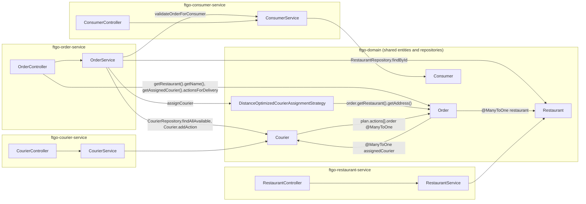

# FTGO microservices decomposition

Epic [AB-585](https://cog-gtm.atlassian.net/browse/AB-585) splits `ftgo-monolith` into four independently deployable
services (consumer, restaurant, courier, order) behind an API gateway, using the strangler-fig pattern and
database-per-service. The monolith keeps running and stays the fallback for every context until AB-595 signs off
parity.

- Decision record: [ADR 0003](../adr/0003-microservices-decomposition.md) (Status: Proposed)
- ARB submission: [arb-submission.md](arb-submission.md) (triage `ARB_REQUIRED`, ARB ticket TO BE CREATED)
- Contract oracle: AB-563 golden JSON in [`docs/upgrade/java21/golden`](../upgrade/java21/golden) and the e2e suite.
  Public REST paths and JSON shapes do not change, whichever side serves a route.

## Context map today

Everything below runs in one JVM (`ftgo-application`, `FtgoApplicationMain` imports `ConsumerServiceConfiguration`,
`OrderServiceConfiguration`, `RestaurantServiceConfiguration`, `CourierWebConfiguration` and
`ApiTrackingConfiguration`) against one schema (`ftgo`). All entities and repositories live in `ftgo-domain`
(`DomainConfiguration`: `@EntityScan` + `@EnableJpaRepositories` over `net.chrisrichardson.ftgo.domain`).

| Caller (class) | Callee | Call | Crosses context? |
| --- | --- | --- | --- |
| `OrderService.createOrder` | restaurant | `RestaurantRepository.findById(restaurantId)`, then `restaurant.findMenuItem(...)` to price line items | yes: order → restaurant |
| `OrderService.createOrder` | consumer | `ConsumerService.validateOrderForConsumer(consumerId, orderTotal)` (in-process; `ftgo-order-service` has a Gradle `api project(":ftgo-consumer-service")` dependency) | yes: order → consumer |
| `OrderService.accept` → `scheduleDelivery` | courier | `CourierRepository.findAllAvailable()`, `CourierAssignmentStrategy.assignCourier(couriers, order)`, `courier.addAction(Action.makePickup/makeDropoff(order))`, `order.schedule(courier)` — one transaction writes `orders` and `courier_actions` | yes: order → courier (write) |
| `OrderService.estimateDeliveryTime` | restaurant | `order.getRestaurant().getAddress()` coordinates + `DistanceOptimizedCourierAssignmentStrategy.haversineDistance` | yes: order → restaurant |
| `DistanceOptimizedCourierAssignmentStrategy.assignCourier` (`ftgo-domain`, wired in `OrderConfiguration`) | restaurant, courier | reads `order.getRestaurant().getAddress()` and `Courier` coordinates / `getActiveDeliveryCount()` | yes: courier assignment needs restaurant location |
| `OrderController.makeGetOrderResponse` | restaurant, courier | `order.getRestaurant().getName()`, `order.getAssignedCourier().getId()`, `order.getAssignedCourier().actionsForDelivery(order)` | yes: order read model joins restaurant + courier |
| `Courier.cancelDelivery` / `Plan.removeDelivery` / `Action.actionFor(Order)` | order | match actions by `Order` entity | yes: courier → order |
| `ConsumerController` → `ConsumerService` | consumer | `create`, `findById` | no |
| `RestaurantController` → `RestaurantService` | restaurant | `create`, `findById` | no |
| `CourierController` → `CourierService` | courier | `createCourier`, `updateAvailability`, `findCourierById`, `updateLocation`; workload read from `Courier.getActiveDeliveryCount()` | no |
| `GlobalExceptionHandler` (`ftgo-application`) | all | maps `RestaurantNotFoundException`, `NoCourierAvailableException`, etc. to HTTP status | monolith-only; services need the same mapping (`ftgo-service-runtime`) |
| `ApiTrackingInterceptor` (`ftgo-common`, `/**` minus `/api/tracking/**`, `/actuator/**`) | monolith | writes `api_request_log` for every request the monolith serves | monolith-only |

Consumer, restaurant and courier make no outbound calls to other contexts today (apart from the courier ↔ order
entity cycle). Order is the only orchestrator, which drives the cut-over order below.

## Data ownership

Every table created by Flyway V1 (`V1__create_ftgo_db.sql`) or V2 (`V2__add_courier_optimization_and_api_tracking.sql`)
has exactly one owner. "Monolith" means `ftgo-application` keeps the table in the `ftgo` schema and no service
gets a copy.

| Table | Created in | Owner | Target schema | Notes |
| --- | --- | --- | --- | --- |
| `consumers` | V1 | consumer service | `ftgo_consumer` | `Consumer` aggregate |
| `hibernate_sequence` | V1 | consumer service | `ftgo_consumer` | Only `Consumer.id` uses it (`@SequenceGenerator(sequenceName = "hibernate_sequence")`); every other entity uses `IDENTITY`. Copied with `next_val` set past the max migrated `consumers.id` |
| `restaurants` | V1 (+ V2 `latitude`, `longitude`) | restaurant service | `ftgo_restaurant` | `Restaurant` aggregate root |
| `restaurant_menu_items` | V1 | restaurant service | `ftgo_restaurant` | `Restaurant.menuItems` element collection; FK to `restaurants` stays (same aggregate) |
| `courier` | V1 (+ V2 `latitude`, `longitude`, `current_latitude`, `current_longitude`, `last_location_update`) | courier service | `ftgo_courier` | `Courier` aggregate root |
| `courier_actions` | V1 | courier service | `ftgo_courier` | `Courier.plan.actions` element collection; FK to `courier` stays; FK `order_id → orders` dropped, column kept as plain `order_id` (AB-590) |
| `orders` | V1 (+ V2 `delivery_address_latitude`, `delivery_address_longitude`) | order service | `ftgo_order` | `Order` aggregate root; `consumer_id` is already a scalar; FKs to `restaurants` and `courier` dropped, columns kept as plain ids (AB-592); additive `restaurant_name` snapshot for `GetOrderResponse.restaurantName` (AB-592) |
| `order_line_items` | V1 | order service | `ftgo_order` | `Order.orderLineItems` element collection; FK to `orders` stays |
| `api_request_log` | V2 | monolith (`ftgo-application`, platform tracking in `ftgo-common`) | `ftgo` (unchanged) | Written by `ApiTrackingInterceptor`, read by `/api/tracking/**`, both of which stay on the monolith. Requests served by a service are not tracked here (follow-up: gateway-level tracking) |

`flyway_schema_history` is Flyway bookkeeping, not a V1/V2 table: each schema has its own (the monolith's in `ftgo`,
each service's in `ftgo_<context>`). During the transition the monolith `ftgo` schema keeps all tables above; at
each context's cut-over the rows are copied into the owner's schema (AB-595) and the service becomes the writer.

Foreign keys in V1 and what happens to them in the service schemas:

| FK (V1) | From → to | Same owner? | Target |
| --- | --- | --- | --- |
| `order_line_items_order_id` | `order_line_items.order_id → orders.id` | yes (order) | kept |
| `restaurant_menu_items_restaurant_id` | `restaurant_menu_items.restaurant_id → restaurants.id` | yes (restaurant) | kept |
| `courier_actions_courier_id` | `courier_actions.courier_id → courier.id` | yes (courier) | kept |
| `courier_actions_order_id` | `courier_actions.order_id → orders.id` | no | dropped; id only |
| `orders_restaurant_id` | `orders.restaurant_id → restaurants.id` | no | dropped; id only |
| `orders_assigned_courier_id` | `orders.assigned_courier_id → courier.id` | no | dropped; id only |

The monolith `ftgo` schema keeps all six FKs; only additive migrations are allowed there.

## The three cross-aggregate JPA links and how each is cut

| # | Link today | FK | Cut | Ticket |
| --- | --- | --- | --- | --- |
| 1 | `Action.order` — `@ManyToOne Order` inside `Courier.plan.actions` (`courier_actions`) | `courier_actions.order_id → orders.id` | Replace with `Long orderId` (same `order_id` column). `Action.makePickup/makeDropoff`, `Plan.removeDelivery`, `Plan.actionsForDelivery`, `Courier.cancelDelivery` take an order id. Courier assignment moves into the courier context behind a `CourierAssignment` API (`POST /couriers/assignments`, input: order id, restaurant coordinates, ready-by / delivery time; output: assigned courier id + actions), with `DistanceOptimizedCourierAssignmentStrategy` moving with it. JSON of `GET /couriers/{courierId}` unchanged (`Action` exposes only `type` and `time`) | [AB-590](https://cog-gtm.atlassian.net/browse/AB-590) |
| 2 | `Order.restaurant` — `@ManyToOne(fetch = LAZY) Restaurant` | `orders.restaurant_id → restaurants.id` | Replace with `Long restaurantId` (same column). `OrderService.createOrder` reads the menu through a `RestaurantCatalog` port (in-process adapter over `RestaurantRepository`; remote adapter over `GET /restaurants/{restaurantId}`, whose response gains menu items additively in AB-589). The restaurant name and coordinates needed later are snapshotted onto the order at creation (`restaurant_name` additive column; coordinates passed to the assignment call) so `GetOrderResponse.restaurantName` and delivery estimates need no cross-service join | [AB-592](https://cog-gtm.atlassian.net/browse/AB-592) (depends on AB-589) |
| 3 | `Order.assignedCourier` — `@ManyToOne Courier` | `orders.assigned_courier_id → courier.id` | Replace with `Long assignedCourierId` (same column). `OrderService.scheduleDelivery` calls a `CourierAssignment` port (in-process adapter over the courier module; remote adapter over `POST /couriers/assignments`) and stores the returned id. `GetOrderResponse.assignedCourier` and `courierActions` come from the assignment result / courier API, not from entity navigation | [AB-592](https://cog-gtm.atlassian.net/browse/AB-592) (depends on AB-590) |

The consumer link is already id-only (`Order.consumerId`); AB-592 replaces the direct `ConsumerService` call with a
`ConsumerValidation` port (remote adapter over `POST /consumers/{consumerId}/validate-order`, added in
[AB-588](https://cog-gtm.atlassian.net/browse/AB-588)) and drops the Gradle dependency on `ftgo-consumer-service`.
Port selection: `ftgo.integration.<context>=in-process|remote`, default `in-process`.

## Route ownership

The gateway (`ftgo-api-gateway`, [AB-591](https://cog-gtm.atlassian.net/browse/AB-591)) matches the prefixes below
and sends each group to the monolith or the service per `ftgo.routing.<context>=monolith|service` (default
`monolith`). Paths are preserved, no rewriting.

| Path prefix | Endpoints today | Owner | Switch |
| --- | --- | --- | --- |
| `/consumers/**` | `POST /consumers`, `GET /consumers/{consumerId}`; internal `POST /consumers/{consumerId}/validate-order` (new, AB-588) | consumer service | `ftgo.routing.consumer` |
| `/restaurants/**` | `POST /restaurants`, `GET /restaurants/{restaurantId}` | restaurant service | `ftgo.routing.restaurant` |
| `/couriers/**` | `POST /couriers`, `GET /couriers/{courierId}`, `POST /couriers/{courierId}/availability`, `POST /couriers/{courierId}/location`, `GET /couriers/{courierId}/workload`; internal `POST /couriers/assignments` (new, AB-590) | courier service | `ftgo.routing.courier` |
| `/orders/**` | `POST /orders`, `GET /orders?consumerId=`, `GET /orders/{orderId}`, `POST /orders/{orderId}/{cancel,revise,accept,preparing,ready,pickedup,delivered}` | order service | `ftgo.routing.order` |
| everything else: `/`, `/index.html`, `/css/**`, `/js/**` (dashboard), `/config/sentry`, `/api/tracking/**`, `/swagger-ui.html`, `/swagger-ui/**`, `/v3/api-docs/**`, `/error` | dashboard, Sentry config, API tracking, Swagger | monolith | none (always monolith) |

Each deployable serves its own `/actuator/**`; the gateway does not proxy actuator paths. Internal endpoints are
reachable through the gateway under their context prefix while traffic is unauthenticated (accepted interim; see
ADR 0003 Security).

## Port map

| Deployable | Module | Host port | Container port | Schema |
| --- | --- | --- | --- | --- |
| Monolith | `ftgo-application` | 8081 (unchanged; e2e default) | 8080 | `ftgo` |
| Consumer service | `ftgo-consumer-service-main` | 8082 | 8080 | `ftgo_consumer` |
| Restaurant service | `ftgo-restaurant-service-main` | 8083 | 8080 | `ftgo_restaurant` |
| Courier service | `ftgo-courier-service-main` | 8084 | 8080 | `ftgo_courier` |
| Order service | `ftgo-order-service-main` | 8085 | 8080 | `ftgo_order` |
| API gateway | `ftgo-api-gateway` | 8088 | 8080 | none |
| MySQL 8.4 | `mysql` (compose) | 3306 | 3306 | all five schemas, one user per schema |

Host port 8080 is not used by any deployable. The e2e suite gets a base-URL override (default stays
`http://$DOCKER_HOST_IP:8081`) so it can target 8088 ([AB-594](https://cog-gtm.atlassian.net/browse/AB-594)).

## Cut-over order

Leaf contexts first, order last, because order calls the other three:

1. **consumer** — no outbound calls; adds `validate-order` used later by order.
2. **restaurant** — no outbound calls; menu read model used later by order.
3. **courier** — after cutting `Action.order` (AB-590); owns courier assignment.
4. **order** — after AB-592 replaces all three dependencies with ports and remote adapters.

Per context: freeze writes for that context, copy its tables from `ftgo` into `ftgo_<context>` (verify counts and
checksums, fix `hibernate_sequence` for consumer), set `ftgo.routing.<context>=service` and
`ftgo.integration.<context>=remote` in the monolith, run e2e through the gateway. Rollback: flip both switches back
and reverse-copy writes made since cut-over. Scripts and runbook: [AB-595](https://cog-gtm.atlassian.net/browse/AB-595).

## Waves

| Wave | Tickets |
| --- | --- |
| 0 | [AB-586](https://cog-gtm.atlassian.net/browse/AB-586) ADR + ARB triage (this doc); [AB-587](https://cog-gtm.atlassian.net/browse/AB-587) build/runtime scaffolding (`*-main` modules, gateway skeleton, `ftgo-service-runtime`, per-service schemas/users) |
| 1 | [AB-588](https://cog-gtm.atlassian.net/browse/AB-588) consumer; [AB-589](https://cog-gtm.atlassian.net/browse/AB-589) restaurant; [AB-590](https://cog-gtm.atlassian.net/browse/AB-590) courier; [AB-591](https://cog-gtm.atlassian.net/browse/AB-591) gateway |
| 2 | [AB-592](https://cog-gtm.atlassian.net/browse/AB-592) order decoupling + standalone order service |
| 3 | [AB-593](https://cog-gtm.atlassian.net/browse/AB-593) local compose topology; [AB-594](https://cog-gtm.atlassian.net/browse/AB-594) CI + e2e against the topology |
| 4 | [AB-595](https://cog-gtm.atlassian.net/browse/AB-595) data migration, cut-over/rollback runbook, parity sign-off (gates the epic) |

## Follow-up epics (out of scope for AB-585)

Filed by AB-595 once parity is signed off:

- **Asynchronous messaging / transactional outbox** (Kafka or Eventuate Tram) behind the ports added in AB-592.
- **Gateway and service-to-service authentication**, including blocking internal endpoints
  (`/consumers/{id}/validate-order`, `/couriers/assignments`) at the gateway and TLS between hops.
- **Kubernetes / Helm packaging** of the five deployables (relates to [AB-402](https://cog-gtm.atlassian.net/browse/AB-402)),
  exposing only the gateway.
- **Retire service code from the monolith**: remove the four contexts from `ftgo-application` and the `ftgo` schema
  once each has run on its service with no rollback for an agreed period.
- **Split `ftgo-domain`**: move `Restaurant`, `Courier`, `Order` and their repositories into their service modules.
- **Gateway-level request tracking** to replace `api_request_log` for service-served traffic.
- **Resilience**: timeouts are in AB-592; circuit breakers / retries (Spring Cloud CircuitBreaker) are a follow-up.
- **Separate MySQL servers per service** if isolation or scaling requires it for a hosted deployment.
